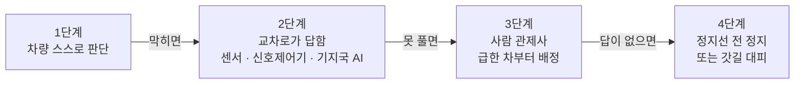

<div align="center">


<br>

**2026 차세대통신 X 융합 창업 아이디어 경진대회 · 제안 설계 저장소**


[한눈에 보기](#한눈에-보기) · [제안서](docs/proposal/README.md) · [대회 규정](docs/contest/rules.md) · [사실 카드](docs/evidence/facts.md) · [시뮬레이션](sim/README.md) · [역할과 일정](docs/team/roles.md)

</div>

---

## 한눈에 보기

운전자가 없는 자율주행차는 판단이 서지 않으면 상황실의 사람에게 묻는다. 정전이나 큰 행사로 여러 대가 한꺼번에 물으면 통신도 사람도 모자라서, 차들이 도로를 막고 선다. 2023년과 2025년 샌프란시스코에서 실제로 일어난 일이다.

**ASK**는 사람보다 교차로가 먼저 답하게 한다. 신호가 무슨 색인지, 횡단보도에 사람이 있는지는 교차로가 이미 알고 있기 때문이다.



| 구분 | 내용 |
|---|---|
| 문제 | 사건 하나가 여러 차량의 요청을 동시에 만들고, 그 순간 통신망과 관제사가 함께 부족해진다 |
| 해결 | 쉬운 질문은 교차로가 바로 답하고, 사람은 어려운 질문만 맡는다. 답이 없으면 차는 안전하게 비켜선다 |
| 차세대통신의 역할 | 급한 요청 먼저 보내기, 두 경로로 함께 보내기(통신 모듈 SafeLink), 기지국 옆 AI(AI-RAN) |
| 검증 | 가정값 기준 모의실험 두 가지. 실제 도로나 실제 통신망 측정은 아니다 |

## 제출물과 상태

| 제출물 | 형식 | 정본 위치 | 상태 |
|---|---|---|---|
| 아이디어 제안서 | PPT 또는 PDF, 10쪽 이내 | [docs/proposal](docs/proposal/README.md) | 쪽별 글 초안 완료, 슬라이드 조립 전 |
| 참가신청서 | 주최 측 양식(HWP) | [docs/application](docs/application/application-form.md) | 기입 안내 완료, 팀명과 역할 확정 전 |

쪽별 진행 상황은 [제안서 목차](docs/proposal/README.md)의 상태표가 정본이다.

## 일정

| 날짜 | 할 일 |
|---|---|
| 11.16 (월) | 역할과 팀명 확정, 쪽별 글 확정 |
| 11.17 (화) | 슬라이드 10쪽 조립, 서로 바꿔 읽기, 참가신청서 작성 |
| **11.18 (수) 오전** | **구글폼 제출** (접수 마감일) |
| 12.3 (목) | 예선 결과 발표 (본선 8~10팀) |
| 12.16 (수) | 본선 발표 자료 제출 (10분 이내) |
| 12.18 (금) | 본선 발표와 시상 (코엑스) |

세부 일정은 [docs/team/schedule.md](docs/team/schedule.md), 제출 전 점검 항목은 [제출 체크리스트](docs/contest/submission-checklist.md)에 있다.

## 저장소 지도

```
ask-nextcomm2026
├── README.md                 대문 (지금 이 문서)
├── AGENTS.md                 AI 도우미가 가장 먼저 읽는 작업 안내
├── docs
│   ├── contest               대회 규정, 심사 기준, 제출 체크리스트
│   ├── proposal              제안서 10쪽 (쪽마다 파일 하나)
│   ├── design                서비스 구조, 메시지 규격, 통신 모듈, 용어집
│   ├── evidence              사실 카드: 인용할 수치와 출처, 확인 상태
│   ├── plain                 쉬운 말 쓰기 규칙, 한 장 소개, 발표 대본, 예상 질문
│   ├── application           참가신청서 기입 안내
│   ├── team                  역할 분담과 일정
│   └── decisions             팀 결정 기록
├── sim
│   ├── surge                 요청 폭주 모의실험
│   └── safelink              긴급 정보 전달률 모의실험
├── refs                      주최 측 원본 자료
└── assets                    대문 그림
```

문서별 용도는 [문서 지도](docs/README.md)에 정리돼 있다.

## 처음 온 팀원에게

1. 저장소를 받는다.

   ```bash
   git clone https://github.com/pikachu515/ask-nextcomm2026.git
   ```

2. [대회 규정](docs/contest/rules.md)과 [역할 분담](docs/team/roles.md)을 읽고 맡을 쪽을 확인한다.
3. 맡은 쪽 파일(`docs/proposal/pNN-*.md`)을 고친다. 숫자를 쓸 때는 [사실 카드](docs/evidence/facts.md)에 있는 것만 쓴다.
4. 글을 쓰기 전에 [쉬운 말 쓰기 규칙](docs/plain/style-guide.md)을 한 번 읽는다. 독자는 통신을 배우지 않은 대학생이다.

모의실험을 돌려 보려면 Python 3.10 이상이 필요하다.

```bash
pip install -r requirements.txt
```

```bash
python sim/surge/surge_sim.py
```

```bash
python sim/safelink/safelink_eval.py
```

## AI 도우미로 작업하기

Claude Code, Codex 같은 AI 코딩 도구는 저장소의 [`AGENTS.md`](AGENTS.md)를 자동으로 읽는다. 대회 규정, 써도 되는 수치, 글쓰기 규칙, 하지 말아야 할 일이 거기에 들어 있다.

채팅형 AI(ChatGPT, Claude 앱 등)를 쓸 때는 아래 세 파일을 함께 붙여 넣으면 같은 기준으로 작업한다.

| 붙여 넣을 파일 | 담긴 내용 |
|---|---|
| [`AGENTS.md`](AGENTS.md) | 작업 규칙과 프로젝트 요약 |
| [`docs/evidence/facts.md`](docs/evidence/facts.md) | 써도 되는 수치와 출처 |
| 맡은 쪽 파일 | 지금 고칠 글 |

## 작업 규칙

- 자기가 맡은 쪽 파일은 `main`에 바로 커밋해도 된다.
- 여럿이 함께 쓰는 파일(`AGENTS.md`, `docs/contest`, `docs/evidence`, `docs/decisions`)은 Pull Request로 올려 한 명 이상의 확인을 받는다.
- 커밋 메시지는 `범위: 한 일` 형식으로 쓴다. 예: `p06: 응답 기한 표 수정`, `sim: 시드 100개로 재실행`.
- 이름, 연락처 같은 개인정보는 어떤 파일에도 쓰지 않는다. 참가신청서는 각자 컴퓨터에서 작성한다.

## 수치와 자료에 대한 고지

- 모의실험 수치는 모두 가정값에서 나온 개념 검증 결과다. 실제 5G·6G 기지국 측정이나 자율주행 안전성 입증이 아니다.
- 인용 수치의 출처와 확인 상태는 [사실 카드](docs/evidence/facts.md)에 적혀 있다. '원문 확인'이 아닌 항목은 제안서에 넣기 전에 원문을 확인한다.
- 2단계의 도로변 센서 구성과 시연 장면은 연구실 브리핑을 허락받아 참고했다. 범위는 [결정 기록 0003](docs/decisions/0003-lab-briefing-scope.md)에 있다.
