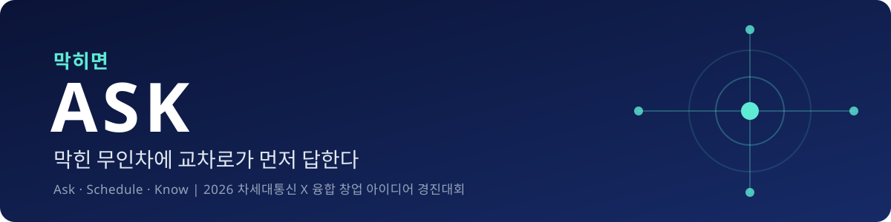
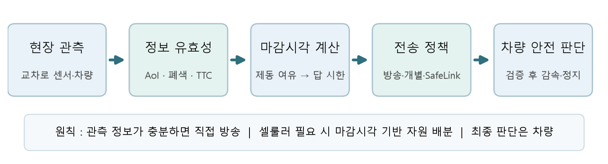
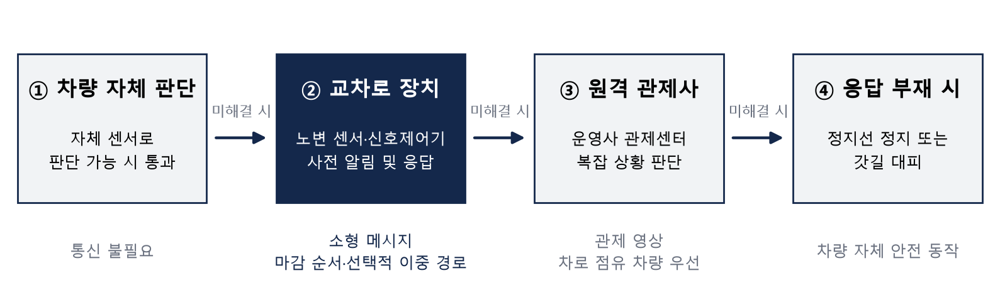
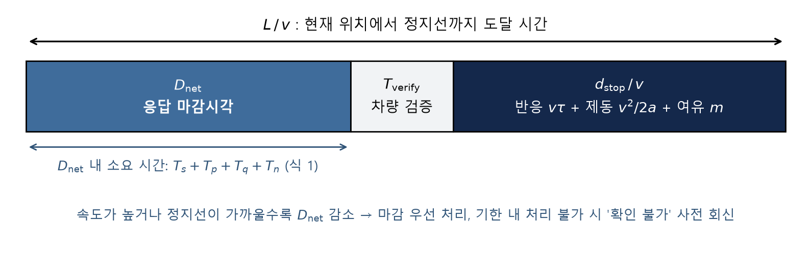
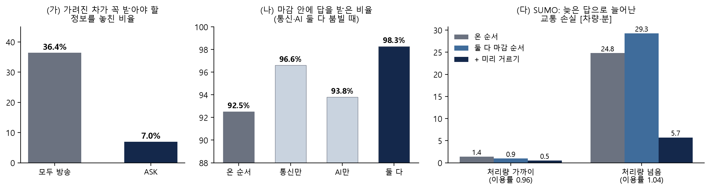

<div align="center">



<br>

**2026 차세대통신 X 융합 창업 아이디어 경진대회 · ASK 아이디어 제안서 및 모의실험 코드**


[제안서 PDF](proposal/ASK_아이디어_제안서.pdf) · [모의실험](sim/README.md) · [실행 방법](#실행-방법) · [저장소 구성](#저장소-구성)

</div>

---

## 개요

운전자 없는 자율주행차는 자체 판단이 어려운 상황에서 운영 회사 관제센터의 **원격 관제사**에게 확인을 요청합니다. 정전이나 대형 행사처럼 하나의 사건이 다수 차량의 요청을 동시에 유발하면 무선망과 관제센터가 함께 포화되어, 응답을 기다리는 차량이 도로를 점유하게 됩니다. 2025년 12월 샌프란시스코 정전 당시 실제로 발생한 상황입니다.

**ASK(Ask · Schedule · Know)** 는 교차로 장치가 이미 확보한 안전 정보를 필요한 차량에 먼저 전달하고, 남은 질의를 차량의 **안전 판단 마감시각** 순서로 처리하는 차세대통신 기반 서비스입니다.

<p align="center"></p>

| 구분 | 내용 |
|---|---|
| 문제 | 동일 사건으로 요청이 집중되면 무선망·엣지 서버·원격 관제사의 대기열이 함께 증가함 |
| 해결 | 교차로 장치가 공통 사건을 사전 방송하고, AoI·폐색·TTC로 차량별 필요 정보를 선별하며, 마감시각 순서로 응답 |
| 차세대통신 | AI-RAN·엣지 컴퓨팅, 5G MBS, NR-PC5 직접통신, 선택적 이중 경로 전송(SafeLink) |
| 원칙 | 외부 정보는 조언이며 최종 판단은 차량이 수행함. 응답이 없으면 차량은 정지선 앞에 정지함 |

## 서비스 구조

차량은 아래 순서로 응답을 구합니다. 대부분의 질의가 교차로 장치에서 해결되면 원격 관제사와 관제 영상 통신의 부하가 줄어듭니다.

<p align="center"></p>

## 핵심 모델

차량의 안전 여유를 통신 응답 마감시각으로 변환하여, 무선 전송과 기지국 옆 AI의 처리 순서에 함께 적용합니다.

$$d_{\mathrm{stop}} = v\tau + \frac{v^2}{2a} + m, \qquad D_{\mathrm{net}} \approx \max\left(0,\ \frac{L - d_{\mathrm{stop}}}{v} - T_{\mathrm{verify}}\right)$$

<p align="center"></p>

보행자 정보는 유효성을 먼저 검사한 뒤, 차량별 정보 가치에 따라 전송 대상을 선택합니다.

$$\mathrm{Valid}_{ij} = S_j \wedge C_{ij} \wedge (\Delta_{ij} \le \mathrm{TTL}_j), \qquad V_{ij} = R_{ij}\,[\,\eta + (1-\eta)\,O_{ij}\,]\,N_{ij}\,U_{ij}$$

기호 정의와 전체 수식은 [제안서 PDF](proposal/ASK_아이디어_제안서.pdf) 2·5·6·7장에 수록되어 있습니다.

## 모의실험 결과

모든 결과는 **가정값 기반** 모의실험이며, 실제 도로나 5G 망에서 측정한 값이 아닙니다.

| 모의실험 | 비교 | 결과 | 코드 |
|---|---|---|---|
| 요청 폭주 | 원격 관제사만 → 교차로 응답 + 관제 영상 품질 유지 | 차로 점유 시간 **68% 감소** (2,853 → 919 차량·분) | [surge](sim/surge) |
| SafeLink 전송 | 도착 순서 → 필요할 때만 두 경로 | 긴급 정보 제시간 전달률 **53.9% → 96.2%** (긴급 순서만으로 92.1%, 두 경로 +4%p) | [safelink](sim/safelink) |
| 정전 사전 알림 | 교차로 응답 → + 신호 꺼짐 사전 알림 | 차량 질의 **16% 감소** (원격 관제사 요청 5% 감소), 차로 점유 추가 6.8% 감소 | [blackout](sim/blackout) |
| 정보 선택 | 전체 순환 방송 → AoI·폐색·TTC 선택 | 필수 보행자 정보 누락 **36.4% → 7.0%**, 사용 자원 1/3 | [selection](sim/selection) |
| 마감시각 순서 | 도착 순서 → 통신·AI 통합 마감 순서 | 마감 내 응답 **92.5% → 98.3%** | [deadline](sim/deadline) |
| 교통 영향 (SUMO) | 도착 순서 → 마감 순서 + 사전 회신 | 처리 용량 초과 시 응답 지연에 따른 교통 손실 **77% 감소** (24.8 → 5.7 차량·분, 시드 10개). 마감 순서만 적용하면 오히려 증가 | [sumo_crossing](sim/sumo_crossing) |

<p align="center"></p>

각 폴더의 README에 가정 조건, 전체 결과, 불리한 조건이 정리되어 있습니다. 예를 들어 무선 자원이 충분하고 방송 비용이 낮으면 전체 방송이 정보 선택보다 누락이 적으며(1% 대 7%), 처리 용량을 초과하는 부하에서는 마감 순서 정렬만으로 교통 손실이 줄지 않습니다.

## 실행 방법

Python 3.10 이상이 필요합니다.

```bash
pip install -r requirements.txt
```

```bash
python sim/surge/surge_sim.py
python sim/safelink/safelink_eval.py
python sim/blackout/blackout_sim.py
python sim/selection/selection_sim.py
python sim/deadline/deadline_sim.py
python sim/sumo_crossing/crossing_sumo.py
```

결과는 각 폴더의 `results`에 저장됩니다. 난수 시드가 고정되어 있어 재실행 시 동일한 결과가 재현됩니다. SUMO 실험은 PyPI의 `eclipse-sumo`(1.28.0)와 `traci`를 사용합니다.

## 저장소 구성

```text
ask-nextcomm2026/
├── proposal/
│   └── ASK_아이디어_제안서.pdf     제출 아이디어 제안서 (10쪽)
├── sim/
│   ├── surge/                      요청 폭주 시 차로 점유
│   ├── safelink/                   긴급 정보 이중 경로 전송
│   ├── blackout/                   정전 시 사전 알림
│   ├── selection/                  AoI·폐색·TTC 기반 정보 선택
│   ├── deadline/                   통신·AI 마감시각 순서 처리
│   └── sumo_crossing/              SUMO 교차로 교통 영향
├── assets/                         README 그림
└── requirements.txt
```

## 향후 계획

- 5G 통신 시뮬레이터(ns-3 5G-LENA)를 이용한 방송·개별 전송의 실제 무선 자원 비용 측정
- SUMO 실험의 신호 교차로 및 다수 교차로 확장
- 노변 센서와 시험용 무선 장비를 이용한 교차로 응답 과정 실물 시연
