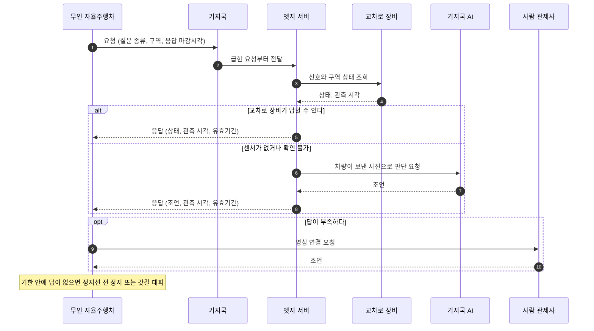

# 서비스 구조

ASK는 무인 자율주행차가 스스로 판단하지 못할 때 답을 구하는 순서를 정한 서비스다. 사람에게 묻기 전에 교차로가 먼저 답하고, 사람과 통신은 급한 차량부터 쓴다.

이름은 차량이 묻고(Ask), 통신망이 급한 순서로 보내고(Schedule), 차량이 알고 판단한다(Know)는 흐름에서 왔다.

## 네 단계

| 단계 | 누가 답하는가 | 무엇을 답하는가 | 통신 |
|---|---|---|---|
| 1 | 차량 자체 | 자기 센서로 판단한다 | 없음 |
| 2 | 교차로: 도로변 센서, 신호제어기. 센서가 없는 곳은 기지국 AI | 신호 상태, 구역 상태, 확인형 질문의 조언 | 작은 요청과 응답. 급한 순서로 전송 |
| 3 | 사람 관제사 | 복잡한 상황의 조언 | 영상. 도로를 막은 차량부터 배정 |
| 4 | 답 없음 | 정지선 전 정지 또는 갓길 대피 | 링크 단절과 기한 초과도 이 단계로 간다 |

어느 단계에서든 답이 확보되면 다음 단계로 가지 않는다.

## 요청에서 판단까지

1. **감지.** 차량이 신호나 예정 경로의 구역을 확인하지 못하거나, 진행 여부를 판단하지 못한다.
2. **요청.** 차량이 질문 종류, 구역, 응답 마감시각을 보낸다. 이 단계에서는 영상을 보내지 않는다.
3. **우선 전송.** 통신망이 마감이 임박한 요청과 도로를 막은 차량의 요청을 먼저 처리한다.
4. **답변.** 엣지 서버가 신호제어기와 도로변 센서의 정보로 답한다. 센서가 없는 곳은 기지국 AI가 차량이 보낸 사진으로 답한다.
5. **판단.** 차량이 답의 관측 시각과 유효기간을 확인하고 스스로 판단한다. 답이 부족하면 사람 관제사로 넘어간다.

메시지 항목과 응답 기한의 계산은 [messages.md](messages.md)에 있다.

## 차량이 묻는 것

| 질문 종류 | 예 | 주로 답하는 곳 |
|---|---|---|
| 신호 상태 | 앞 트럭에 가려 신호등이 안 보인다. 지금 무슨 신호인가 | 신호제어기 |
| 구역 상태 | 트럭 뒤 횡단보도에 사람이 있는가 | 도로변 센서 |
| 진행 확인 | 신호등이 꺼졌다. 지금 지나가도 되는가 | 도로변 센서, 기지국 AI |
| 경로 조언 | 공사로 차로가 막혔다. 어떻게 돌아가야 하는가 | 기지국 AI, 사람 관제사 |

## 구역 상태와 차량 동작

2단계에서 도로변 센서가 답하는 구역 상태는 세 가지다. 구성과 판정 방식은 [roadside-sensing.md](roadside-sensing.md)에 있다.

| 구역 상태 | 뜻 | 차량 동작 |
|---|---|---|
| 점유 | 구역 안에 사람이나 차량이 있거나 들어올 것으로 예상된다 | 정지선 전 대기 |
| 관측상 비어 있음 | 최근까지 관측했고 점유와 접근 위험이 없다 | 신호와 자체 안전 조건을 확인한 뒤 통과 |
| 확인 불가 | 센서 가림, 데이터 만료, 센서 불일치 | 진입 보류. 3단계나 4단계로 넘어간다 |

## 상황별 대응

| 상황 | 2단계: 교차로 | 3단계: 사람 | 4단계: 답 없음 |
|---|---|---|---|
| 대형차가 신호등을 가림 | 신호제어기의 신호 상태를 받는다 | 필요 없음 | 정지선 전 정지 |
| 트럭 뒤 횡단 구역이 안 보임 | 도로변 레이다와 라이다의 구역 상태를 받는다 | 확인 불가가 이어지면 관제사 | 정지선 전 대기 |
| 정전으로 신호등이 꺼짐 | 구역 상태와 기지국 AI의 조언을 받는다 | 교차로가 복잡하면 관제사 | 갓길 대피 |
| 공사나 이중주차로 길이 막힘 | 기지국 AI가 사진으로 우회 가능 여부를 조언한다 | 관제사가 영상으로 경로를 조언한다 | 갓길 대피 |

카메라 오염은 다루지 않는다. 교차로를 지난 뒤에도 계속 안 보이므로 교차로 정보로는 풀리지 않는다([결정 0001](../decisions/0001-combined-plan.md)).

## 구성 요소

| 요소 | 하는 일 | 시연 범위 | 제안 범위 |
|---|---|---|---|
| 차량 | 응답 마감시각 계산, 요청, 답의 검증, 최종 판단 | 구동 차량과 무선 단말 | 무인 자율주행차 |
| 무선 구간 | 요청과 응답 전달, 급한 순서 처리 | 시험용 AP와 게이트웨이 | 5G 기지국, 5G 직접통신 |
| 엣지 서버 | 구역 판정, 응답 구성, 사건 전체 파악 | 도로변 엣지 PC | 통신사 기지국 가까이의 엣지 |
| 교차로 장비 | 신호 상태 수집, 구역 관측 | 모형 신호제어기, 4D 레이다, 라이다 | 실제 신호제어기와 도로변 센서 |
| 기지국 AI | 차량이 보낸 사진으로 확인형 질문에 조언 | 다루지 않음 | 기지국 장비에서 도는 AI (AI-RAN) |
| 관제 | 복잡한 상황의 조언, 급한 차량부터 배정 | 모의실험으로 보임 | 운영사의 관제센터 |

## 원칙

- **답은 조언이다.** 최종 판단은 언제나 차량이 한다. 웨이모의 원격지원도 같은 원칙이다(F-02).
- **답이 없으면 멈춘다.** 통신이 끊기거나 기한을 넘기면 정지선 전에 서거나 갓길로 비킨다. "멈추지 않고 달린다"를 약속하지 않는다.
- **엣지는 구역 전체를 본다.** 정전 구역처럼 차량 한 대가 알 수 없는 정보를 여러 차량에 같은 기준으로 알려 준다.
- **통신 성공과 안전한 주행은 다르다.** 메시지가 도착했어도 오래된 정보면 쓰지 않는다.

## 어디서 온 내용인가

| 내용 | 출처 |
|---|---|
| 요청과 응답 구조, 응답 마감시각, 플랜 A~D | 팀 구성안 |
| 문제 정의의 확장, 네 단계, 기지국 AI, 급한 차량 배정 | [결정 0001](../decisions/0001-combined-plan.md) |
| 구역 상태 세 가지, 도로변 센서 구성, 시연 장면 | 연구실 브리핑 ([결정 0003](../decisions/0003-lab-briefing-scope.md)) |
| 전송 정책, 신선도 검사, 기한의 여유 항 | SafeLink 보고서 ([결정 0002](../decisions/0002-safelink-as-comm-module.md)) |
