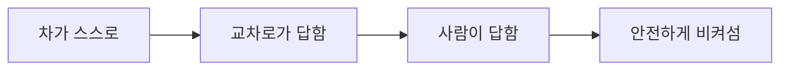

# 1쪽 · 막히면 ASK

| 심사 항목 | 담당(안) | 상태 |
|---|---|---|
| 전체 요약 | 총괄 | 글 초안 |

## 이 쪽이 전할 한 가지

막힌 무인차에게 사람보다 교차로가 먼저 답하게 한다.

## 슬라이드에 넣을 글

> **막히면 ASK**
> 길에서 막힌 무인차에게, 교차로가 먼저 답해 줍니다

| | |
|---|---|
| **문제** | 운전자가 없는 자율주행차는 판단이 서지 않으면 상황실의 사람에게 묻습니다. 정전이나 큰 행사로 여러 대가 한꺼번에 물으면 통신도 사람도 모자라서, 차들이 도로 한가운데 멈춰 섭니다. |
| **해결** | 신호가 무슨 색인지, 횡단보도에 사람이 있는지는 교차로가 이미 알고 있습니다. 그런 질문은 교차로가 바로 답하고, 사람은 어려운 질문만 맡습니다. |
| **효과** | 사람을 기다리며 도로를 막는 시간이 줄어듭니다. 끝까지 답을 못 받은 차는 정지선 앞에 서거나 갓길로 비켜섭니다. |

**차세대통신이 하는 일**
급한 요청을 먼저 보냅니다 · 중요한 정보는 두 길로 함께 보냅니다 · 기지국 옆에서 AI가 답합니다

**숫자 하나**
모의실험에서 차가 도로를 막고 선 시간이 68% 줄었습니다. (가정값 기준)

## 그림

네 단계를 한 줄로 그린다. 4쪽 그림을 줄인 것이다.

## 말로 풀면

운전자가 없는 자율주행 택시도 가끔 판단이 서지 않습니다. 그럴 때는 회사 상황실에 묻습니다. 평소에는 괜찮은데, 정전처럼 여러 대가 한꺼번에 묻는 일이 생기면 답을 기다리는 줄이 길어지고 차들은 길에 서 있게 됩니다. 저희는 차가 묻는 것 가운데 많은 수를 교차로가 이미 알고 있다는 점에 주목했습니다. 그래서 교차로가 먼저 답하고, 사람은 어려운 질문만 맡게 했습니다.

## 근거

- 문제: F-03, F-04
- 숫자: S-01. 갓길 대피 단계를 뺀 값이다

## 남은 일

- [ ] 팀명과 아이디어명을 넣는다
- [ ] 모의실험 수치를 넣을지, 넣는다면 68% 하나만 쓸지 정한다
