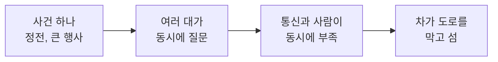

# 2쪽 · 무인차는 막히면 사람에게 묻습니다

| 심사 항목 | 담당(안) | 상태 |
|---|---|---|
| 문제 및 필요성 | 총괄 | 글 초안 |

## 이 쪽이 전할 한 가지

차가 고장 난 것이 아니다. 물어볼 곳이 막힌 것이다.

## 슬라이드에 넣을 글

> 차가 고장 난 것이 아닙니다. 물어볼 곳이 막힌 것입니다.

- 운전자가 없는 자율주행차도 판단이 서지 않을 때가 있습니다. 그럴 때는 휴대전화 통신으로 상황실에 도움을 청합니다.
- 웨이모는 차 3,000대를 상시 근무자 약 70명이 돕습니다. 평소에는 이 인원으로 충분합니다.

| 언제, 어디서 | 무슨 일이 있었나 | 왜 그랬나 |
|---|---|---|
| 2023년 8월 샌프란시스코 | 무인택시 최대 10대가 약 20분 동안 도로를 막았습니다 | 큰 축제로 휴대전화 통신이 붐벼 상황실과 연결이 늦어졌습니다 |
| 2025년 12월 샌프란시스코 | 정전으로 신호등이 꺼지자 무인택시들이 교차로에 멈춰 섰습니다 | "지나가도 되나요?"라는 확인 요청이 한꺼번에 몰려 답이 늦어졌습니다 |

**두 사고는 같은 모양입니다.**
사건 하나 → 여러 대가 동시에 질문 → 통신과 사람이 동시에 부족 → 차가 도로를 막음

## 그림

위 네 칸을 화살표로 이은 그림을 직접 그린다. 사고 현장 사진을 쓰려면 출처를 적고 써도 되는 사진인지 확인한다. 확인이 어려우면 사진 없이 그림만 쓴다.

## 말로 풀면

2023년 8월 어느 금요일 밤, 샌프란시스코 도로 한가운데에 무인택시 열 대가 멈춰 섰습니다. 차가 고장 난 것이 아니었습니다. 근처에서 큰 축제가 열려 휴대전화 통신이 붐볐고, 차들이 상황실과 연결되지 못했습니다. 2025년 12월에는 정전으로 신호등이 꺼졌습니다. 차들은 "지금 지나가도 되나요?" 하고 상황실에 물었는데, 여러 대가 한꺼번에 묻다 보니 답을 기다리는 줄이 길어졌습니다. 그동안 차들은 교차로에 서 있었습니다.

두 사고는 원인이 달라 보이지만 모양이 같습니다. 사건 하나가 여러 대의 질문을 동시에 만들었고, 바로 그 순간 통신과 사람이 함께 모자랐습니다. 차가 늘어날수록 같은 일은 더 크게 일어납니다.

## 근거

- 웨이모의 차량 수와 근무자 수: F-01
- 사람은 조언만 하고 차가 최종 판단한다: F-02
- 2023년 사고: F-03
- 2025년 사고: F-04, F-05

## 남은 일

- [ ] 사고 사진을 쓸지 정한다. 쓰면 출처와 사용 가능 여부를 확인한다
- [ ] 웨이모의 공식 설명 원문을 열어 F-04의 표현을 다시 맞춘다
