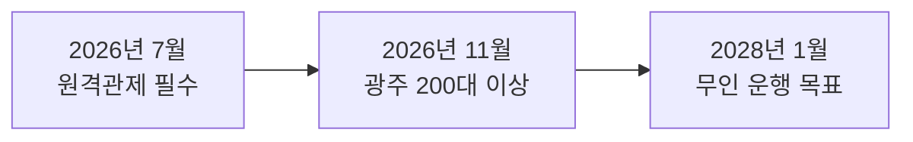

# 3쪽 · 우리나라도 곧 같은 상황을 만납니다

| 심사 항목 | 담당(안) | 상태 |
|---|---|---|
| 문제 및 필요성 | 총괄 | 글 초안 |

## 이 쪽이 전할 한 가지

답은 이미 교차로에 있다. 없는 것은 묻는 차에게 제때 전해 주는 통신이다.

## 슬라이드에 넣을 글

> 원격으로 돕는 일은 이미 필수입니다. 그런데 요청이 몰리는 순간을 감당할 방법은 없습니다.

- 2026년 7월 국토교통부 가이드라인은 운전자가 없는 자율주행차에 원격관제를 꼭 하도록 했습니다.
- 광주에는 2026년 11월부터 자율주행차 200대 이상이 들어오고, 2028년 1월에는 사람이 타지 않는 운행이 목표입니다.
- 한 도시에 수백 대가 달리면 정전이나 행사 하나가 수십 대의 질문을 동시에 만듭니다.

| 지금 쓰는 방법 | 하는 일 | 부족한 점 |
|---|---|---|
| 차 혼자 판단 | 모르겠으면 속도를 줄이거나 멈춥니다 | 가려진 곳이나 꺼진 신호는 알 길이 없습니다 |
| 사람이 원격으로 도움 | 상황실에서 영상을 보고 알려 줍니다 | 요청이 몰리면 줄을 서야 합니다. 통신이 붐비면 영상도 늦습니다 |
| 도로가 정보를 방송 (C-ITS) | 신호와 위험 정보를 주변 차에 뿌립니다 | 전용 장비가 필요하고, 차가 묻는 것에 답하지는 않습니다 |
| 내비게이션 신호 안내 | 앱에 신호가 바뀔 때까지 남은 시간을 보여 줍니다 | 사람 운전자를 위한 것이고, 여러 서버를 거쳐 옵니다 |

**필요한 답의 상당수는 이미 교차로에 있습니다.**
신호가 무슨 색인지는 신호등을 움직이는 장치가 알고, 횡단보도에 사람이 있는지는 길가의 센서가 압니다. 없는 것은 그 답을 묻는 차에게 제때 전해 주는 통신입니다.

## 그림

표를 중심에 둔다. 옆에 광주의 일정을 작은 띠로 넣는다.

## 말로 풀면

미국만의 일이 아닙니다. 우리나라도 2026년 7월부터 운전자가 없는 자율주행차에는 원격으로 지켜보는 체계를 꼭 갖추도록 했습니다. 광주에는 2026년 11월부터 자율주행차 200대 이상이 들어오고, 2028년 1월에는 사람이 타지 않는 운행을 목표로 합니다.

지금 쓰는 방법들은 저마다 빈 곳이 있습니다. 차 혼자서는 가려진 곳을 볼 수 없고, 사람에게 묻는 방법은 요청이 몰리면 줄이 생깁니다. 그런데 생각해 보면 차가 묻는 것의 많은 수는 교차로가 이미 알고 있습니다. 신호가 무슨 색인지, 횡단보도에 사람이 있는지 말입니다. 부족한 것은 그 답을 묻는 차에게 제때 전해 주는 통신입니다.

## 근거

- 가이드라인: F-06. 가이드라인 원문은 아직 열어 보지 못했다
- 광주 실증도시: F-07
- C-ITS의 통신 방식과 지연: F-08
- 신호를 미리 알면 급감속이 준다는 실측(강릉 6곳, 14%p): F-10. 쓰려면 팀 출처의 링크를 확인한다

## 남은 일

- [ ] 국토교통부 가이드라인 원문을 찾아 F-06을 '원문 확인'으로 바꾼다
- [ ] F-10을 이 쪽에 넣을지 정한다. 넣으면 "사람 운전자 기준"을 함께 적는다
