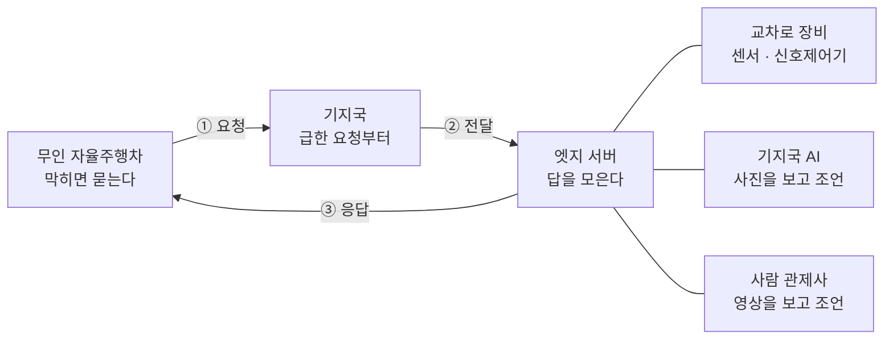

# 4쪽 · 막히면 묻고, 교차로가 먼저 답합니다

| 심사 항목 | 담당(안) | 상태 |
|---|---|---|
| 아이디어 내용 | 서비스·센싱 | 글 초안 |

## 이 쪽이 전할 한 가지

사람에게 가던 질문의 상당수는 교차로가 이미 답을 알고 있다.

## 슬라이드에 넣을 글

> 사람에게 가던 질문의 상당수는 교차로가 이미 답을 알고 있습니다.

1. **모르는 것을 알아챕니다.** 신호가 안 보인다, 트럭 뒤가 안 보인다, 지나가도 될지 모르겠다.
2. **묻습니다.** 무엇이 궁금한지, 어느 자리인지, 언제까지 답이 필요한지만 짧게 보냅니다. 영상은 아직 보내지 않습니다.
3. **급한 질문부터 갑니다.** 통신망이 마감이 가까운 질문과 도로를 막고 선 차의 질문을 먼저 보냅니다.
4. **교차로가 답합니다.** 신호등을 움직이는 장치와 길가의 센서가 아는 내용이면 바로 답합니다. 센서가 없는 곳은 기지국 옆의 AI가 차가 보낸 사진을 보고 답합니다.
5. **차가 확인하고 결정합니다.** 답이 언제 본 정보인지 확인하고, 오래됐으면 쓰지 않습니다. 답이 모자라면 사람에게 넘어갑니다.

**답은 조언입니다. 운전은 끝까지 차가 결정합니다.**

## 그림

이 쪽의 중심 그림이다. 아래 구조를 슬라이드 도구로 다시 그린다.

그림 아래에 작은 글씨로 넣는다.

- 요청에 담는 것: 차량 번호, 질문 종류, 가려는 방향, 궁금한 구역, 답이 필요한 마감시각
- 응답에 담는 것: 답, 답을 본 시각, 답을 쓸 수 있는 기한

## 말로 풀면

차가 답을 구하는 과정은 다섯 걸음입니다. 먼저 차가 자기가 모르는 것을 알아챕니다. 앞에 선 트럭 때문에 신호등이 안 보인다거나, 트럭 뒤 횡단보도가 안 보인다거나 하는 경우입니다. 그러면 차는 짧게 묻습니다. 이때 영상을 통째로 보내지 않고, 무엇이 궁금한지와 언제까지 답이 필요한지만 보냅니다.

통신망은 급한 질문부터 보냅니다. 답은 교차로가 합니다. 신호가 무슨 색인지는 신호등을 움직이는 장치가, 횡단보도에 사람이 있는지는 길가의 센서가 알고 있으니까요. 센서가 없는 교차로에서는 기지국 옆에 있는 AI가 차가 보낸 사진을 보고 답합니다.

마지막으로 차는 받은 답이 언제 본 정보인지 확인합니다. 오래된 답은 쓰지 않습니다. 그리고 답은 어디까지나 조언입니다. 운전은 끝까지 차가 결정합니다.

## 근거

- 구조와 메시지 항목: [design/overview.md](../design/overview.md), [design/messages.md](../design/messages.md)
- 사람도 조언만 하는 것이 업계의 원칙이다: F-02

## 남은 일

- [ ] 흐름 그림을 슬라이드용으로 다시 그린다
- [ ] "엣지 서버"를 그대로 쓸지 "교차로 옆 컴퓨터"로 풀어 쓸지 정한다. 풀어 쓰면 처음 한 번만 괄호로 "엣지 서버"를 덧붙인다
