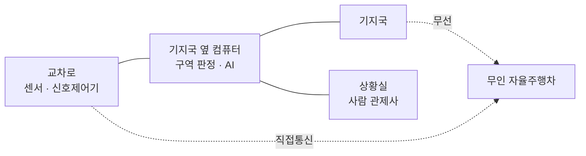

# 7쪽 · 무거운 데이터는 기지국 옆에서 처리합니다

| 심사 항목 | 담당(안) | 상태 |
|---|---|---|
| 차세대통신 활용, 융합성 | 통신·시뮬레이션 | 글 초안 |

## 이 쪽이 전할 한 가지

보내는 것마다 통신에 바라는 것이 다르다. 가장 무거운 것은 영상이고, 그래서 AI를 기지국 옆에 둔다.

## 슬라이드에 넣을 글

> 보내는 것마다 통신에 바라는 것이 다릅니다. 가장 무거운 것은 영상입니다.

| 보내는 것 | 크기 | 통신에 바라는 것 | 쓰는 기술 |
|---|---|---|---|
| 차의 질문 | 아주 작음 | 빨리 올라가기 | 급한 순서대로 보내기 |
| 교차로의 답 | 작음 | 빨리, 빠짐없이 | 급한 순서, 두 길, 가까운 컴퓨터 |
| 가려진 자리의 센서 데이터 | 큼 | 넓은 통신 폭 | 5G 직접통신 |
| 차가 찍은 사진 | 중간 | 올려 보내는 용량 | 기지국 옆 AI |
| 사람이 보는 영상 | 매우 큼 | 올려 보내는 용량, 끊기지 않기 | 영상 전용 차선 |

- **AI를 기지국 옆에 둡니다.** 사진과 영상을 먼 데이터센터까지 보내지 않아도 되어, 통신 부담과 기다리는 시간이 줄어듭니다. 기지국 장비에서 AI를 함께 돌리는 이 방식을 AI-RAN이라고 합니다.
- **기다리는 차는 영상을 보내지 않습니다.** 사람이 맡은 차만 버스전용차로 같은 영상 전용 차선을 받습니다.
- **묻고 답하려면 5G 직접통신이 필요합니다.** 지금 국내 표준 방식은 주변에 뿌리는 방송만 됩니다.

**공모 분야와의 대응**
차세대통신: AI-RAN, 네트워크 AI, 엣지컴퓨팅, 초연결 네트워크 · 융합기술: 생성형 AI, 센싱 · 적용 분야: 미래모빌리티, 스마트시티, 재난·안전

## 그림

표가 중심이다. 옆에 교차로, 기지국, 기지국 옆 컴퓨터가 어디에 놓이는지 작게 그린다.

## 말로 풀면

차와 교차로가 주고받는 것은 크기가 제각각입니다. 차의 질문과 교차로의 답은 문자 메시지처럼 작습니다. 이런 것은 빨리 가기만 하면 됩니다. 반대로 사람이 보는 영상은 아주 큽니다. 여러 대가 동시에 영상을 올려 보내면 통신이 금방 찹니다.

그래서 두 가지를 합니다. 먼저 AI를 기지국 바로 옆에 둡니다. 차가 찍은 사진을 멀리 보내지 않고 가까운 곳에서 바로 보고 답합니다. SK텔레콤이 2026년 7월부터 인천과 판교에 이런 방식의 실증망을 만들고 있습니다. 다음으로, 답을 기다리는 차는 영상을 보내지 않게 합니다. 사람이 맡은 차만 영상을 보내고, 그 차에는 버스전용차로처럼 영상만 다니는 전용 차선을 줍니다.

## 정확히 말하면

발표 뒤 질문에 대비한 설명이다. 슬라이드에는 넣지 않는다.

- 영상 전용 차선은 네트워크 슬라이싱과 통신사의 품질 보장 API를 가리킨다.
- 국내 표준인 LTE-V2X의 직접통신은 방송만 지원한다. 특정 상대와 1:1로 주고받고 수신 확인을 하는 기능은 5G 직접통신(NR 사이드링크, 3GPP Rel-16)부터 들어갔다.
- 실물 시연에서는 기지국 옆 컴퓨터 대신 도로변 엣지 PC를 쓴다. 통신사 엣지와 AI-RAN은 제안 범위다.
- 멀리 보면 길가의 레이다가 하는 일의 일부를 기지국 전파가 맡을 수 있다(통신·센싱 융합). 연구 단계 기술이다.

## 근거

- AI-RAN 선도망: F-17
- 직접통신: F-11
- 구성: [design/overview.md](../design/overview.md)

## 남은 일

- [ ] 표가 한 쪽에 편하게 들어가는지 본다. 넘치면 "가려진 자리의 센서 데이터" 줄을 뺀다
- [ ] 공모 분야 대응을 쪽 아래 한 줄로 넣을지 뺄지 정한다
