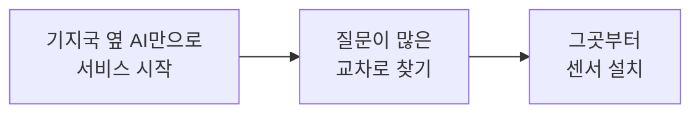

# 9쪽 · 누가 쓰고, 어디서 시작하는가

| 심사 항목 | 담당(안) | 상태 |
|---|---|---|
| 사업화 및 확장 가능성 | 총괄 | 글 초안 |

## 이 쪽이 전할 한 가지

원격관제를 꼭 해야 하는 무인차 운영 회사가 첫 고객이고, 질문이 몰리는 교차로부터 시작한다.

## 슬라이드에 넣을 글

> 첫 고객은 무인 자율주행차를 운영하는 회사입니다. 질문이 몰리는 교차로부터 시작합니다.

| 누가 | 무엇이 좋아지나 | 어떻게 돈을 내나 (안) |
|---|---|---|
| 무인 자율주행차 운영 회사 | 상황실 직원 한 명이 맡을 수 있는 차가 늘어납니다. 차가 도로를 막는 일이 줄어듭니다 | 차 한 대당 월 이용료, 질문 건수에 따른 요금 |
| 지자체, 도로 관리 기관 | 교차로마다 안전 서비스를 붙일 수 있습니다 | 교차로당 설치비와 운영비 |
| 통신사 | 기지국 옆 AI와 컴퓨터를 실제로 쓰는 서비스가 생깁니다 | 공동 사업 또는 이용 수수료 |

**시작하는 방법**

1. 광주 같은 실증 도시에서 시작합니다. 처음에는 길가에 센서를 달지 않고, 기지국 옆 AI만으로 서비스합니다.
2. 차들이 어디서 많이 묻는지 기록을 모읍니다.
3. 질문이 몰리는 교차로를 골라 그곳부터 센서를 답니다.

**왜 지금인가**

- 2026년 7월부터 운전자가 없는 자율주행차에는 원격관제가 필수입니다.
- 광주에 2026년 11월부터 200대 이상이 들어옵니다.
- 전용 도로 인프라 사업은 늦어지고 있습니다. 이미 깔린 이동통신망으로 시작할 수 있습니다.

**후원 기업과의 연결**

- SK텔레콤이 인천과 판교에 만드는 AI-RAN 실증망은 지금 공장과 물류 현장 서비스를 다룹니다. ASK는 같은 망에 올릴 수 있는 도로 교통 서비스입니다.
- AWS의 클라우드는 AI를 학습시키고 질문 기록을 분석하는 데 씁니다.

## 그림

고객 표가 중심이다. "시작하는 방법" 세 걸음을 화살표로 작게 그린다.

## 말로 풀면

누가 돈을 낼까요? 가장 먼저는 무인 자율주행차를 운영하는 회사입니다. 이 회사들은 2026년 7월부터 원격으로 차를 지켜보는 체계를 꼭 갖춰야 합니다. 차가 100대에서 1,000대로 늘 때 상황실 직원을 열 배로 늘릴 수는 없습니다. 쉬운 질문을 교차로가 받아 주면 같은 인원으로 더 많은 차를 맡을 수 있습니다.

길가에 센서를 다는 데는 돈이 듭니다. 그래서 처음부터 모든 교차로에 달지 않습니다. 먼저 기지국 옆 AI만으로 시작하고, 차들이 어디서 많이 묻는지 기록을 모읍니다. 그 기록을 보고 질문이 몰리는 교차로부터 센서를 답니다.

## 정확히 말하면

- 수익 모델은 안이다. 팀에서 확정한다.
- 시장 규모 수치는 아직 없다. 운영 회사 수, 차량 대수, 차 한 대당 관제 비용을 곱하는 방식이 설명하기 쉽다.
- SK텔레콤과 AWS가 함께 만든 5G 엣지 클라우드를 엣지 서버의 후보로 들 수 있지만, 지금도 운영 중인지 확인하지 못했다(F-18). 확인 전에는 슬라이드에 넣지 않는다.
- 같은 방식의 원격지원이 필요한 배달 로봇, 무인 이송 차량으로 넓힐 수 있다.
- 웨이모처럼 큰 회사는 직접 만든다. 대상은 자체 관제센터를 크게 꾸리기 어려운 국내 운영 회사다.

## 근거

- 가이드라인: F-06. 광주: F-07. C-ITS 지연: F-08
- AI-RAN 실증망: F-17

## 남은 일

- [ ] 시장 규모 수치와 계산 방법을 넣는다
- [ ] 수익 모델을 확정한다
- [ ] F-18을 확인한 뒤 AWS 문장을 보강한다
