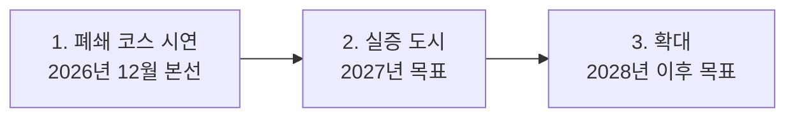

# 10쪽 · 어떻게 확인하고, 어디까지 넓히는가

| 심사 항목 | 담당(안) | 상태 |
|---|---|---|
| 사업화 및 확장 가능성, 검증 | 서비스·센싱 | 글 초안 |

## 이 쪽이 전할 한 가지

요청이 몰리는 상황은 모의실험으로, 교차로의 답은 실물 장비로 확인한다.

## 슬라이드에 넣을 글

> 요청이 몰리는 상황은 모의실험으로, 교차로의 답은 실물 장비로 확인합니다.

**모의실험: 질문이 10배로 몰리는 30분** (차 200대, 상황실 직원 5명, 가정값 기준)

| 방식 | 차가 도로를 막은 시간 | 사람만 쓸 때와 비교 |
|---|--:|--:|
| 사람만 답함 | 2,853 | 기준 |
| 교차로가 먼저 답함 | 1,777 | 38% 감소 |
| 영상 통신 품질도 지킴 | 919 | 68% 감소 |
| 급한 차부터 배정, 답 없으면 비켜섬 | 216 | 92% 감소 |

단위는 "도로를 막은 차의 수 × 분"입니다. 마지막 줄은 비켜설 수 있는 차가 얼마나 되는지의 가정에 따라 달라집니다.

**본선에서 실물로 보일 세 장면**

| 장면 | 보여 줄 것 |
|---|---|
| 트럭 뒤에서 다가옴 | 차에서는 안 보이는 표적을 길가의 레이다가 먼저 잡아 차에 알립니다 |
| 횡단 중 멈춤 | 횡단보도 위에 선 표적을 라이다가 계속 잡고, 차는 초록불에도 기다립니다 |
| 통신 끊김 | 답이 오지 않으면 차가 정지선 앞에 섭니다 |

**넓혀 가는 순서**

1. **폐쇄 코스 시연** (2026년 12월 본선): 시험용 무선 장비로 묻고 답하기와 1, 2, 4단계를 확인합니다.
2. **실증 도시** (2027년 목표): 5G와 통신사의 가까운 컴퓨터에 연결하고, 기지국 AI와 급한 차 배정을 적용합니다.
3. **확대** (2028년 이후 목표): 통신이 나빠질 구간을 미리 알려 주는 기능, 주변 차의 센서 나눠 쓰기, 기지국 전파로 감지하기로 넓힙니다.

모의실험은 저희가 정한 가정에서 나온 값입니다. 실제 도로와 실제 통신망에서 잰 값이 아닙니다.

## 그림

모의실험 그래프와 로드맵을 넣는다. 그래프는 [sim/surge/results/fig1_blocking_over_time.png](../../sim/surge/results/fig1_blocking_over_time.png)를 쓴다.

## 말로 풀면

이 서비스가 정말 효과가 있는지 두 가지로 확인합니다.

하나는 컴퓨터로 해 본 가상 실험입니다. 차 200대가 달리는 도시에서 정전으로 질문이 평소의 10배로 몰리는 30분을 만들어 봤습니다. 사람만 답할 때는 200대 가운데 최대 146대가 동시에 멈췄습니다. 교차로가 먼저 답하게 하니 도로를 막은 시간이 38% 줄었고, 영상 통신 품질까지 지키니 68% 줄었습니다. 교차로가 먼저 답하는 것만으로는 부족하고, 통신이 함께 받쳐 줘야 효과가 크다는 뜻입니다.

다른 하나는 실물입니다. 본선에 가면 길가에 놓는 레이다와 라이다로 세 장면을 보이려고 합니다. 트럭 뒤에서 다가오는 표적을 먼저 잡는 장면, 횡단보도 위에 멈춘 표적을 계속 잡는 장면, 통신이 끊기면 차가 정지선 앞에 서는 장면입니다.

## 정확히 말하면

- 모의실험은 시드 100개의 평균이다. 가정값과 한계는 [sim/surge/README.md](../../sim/surge/README.md)에 있다.
- 급한 차부터 배정하면 도로를 막지 않은 차의 대기는 길어진다. 요청의 95%가 해결되는 시간이 708초에서 1,067초로 는다. 이 대가를 숨기지 않는다.
- 로드맵 2단계와 3단계의 시기는 광주의 일정(2028년 1월 무인 운행 목표)에 맞춘 목표다.
- 교차로 센서 구성과 시연 세 장면은 연구실 설계를 참고했다([결정 0003](../decisions/0003-lab-briefing-scope.md)).
- 본선에서 실물 시연이 가능한지, 영상으로 대신해야 하는지는 아직 확인하지 못했다.

## 근거

- 요청 폭주 모의실험: S-01
- 시연 장면과 측정 지표: [design/roadside-sensing.md](../design/roadside-sensing.md)
- 광주의 일정: F-07

## 남은 일

- [ ] 표 두 개와 로드맵이 한 쪽에 들어가는지 본다. 넘치면 시연 표를 한 줄로 줄인다
- [ ] 연구실 설계를 참고했다는 한 줄을 넣는다
- [ ] 본선에서 연구실 장비를 쓸 수 있는지 확인한다
