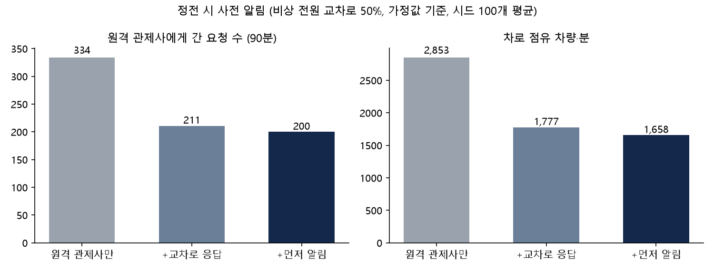

# 정전 시 사전 알림 모의실험

신호가 소등된 교차로에서 교차로 장치가 "신호 꺼짐"을 사전 방송할 때, 원격 관제사에게 전달되는 확인 요청과 차로 점유 시간의 감소 정도를 분석합니다. [요청 폭주 모의실험](../surge/README.md)과 동일한 도시, 사건 구간, 난수를 사용하므로 "원격 관제사만"과 "+교차로 응답"의 결과는 요청 폭주 모의실험과 일치합니다.

## 실행 방법

```bash
python blackout_sim.py
```

시드 100개 기준 약 1분이 소요되며, 결과는 `results` 폴더에 저장됩니다.

| 파일 | 내용 |
|---|---|
| `results/blackout_summary.csv` | 방식별 평균 |
| `results/blackout_power_sweep.csv` | 비상 전원 교차로 비율(0~100%)별 결과 |
| `results/fig1_blackout_compare.png` | 원격 관제사 요청 수와 차로 점유 시간 비교 |
| `results/fig2_power_sweep.png` | 비상 전원 비율에 따른 차로 점유 시간 |

## 모델 확장 내용

요청 폭주 모의실험의 2초 단위 계산에 사전 알림 기능을 추가했습니다. 사건 구간에서 차량이 확인형 질의를 하려 할 때 다음 세 조건을 모두 만족하면 질의 없이 자체 판단으로 통과합니다.

1. 해당 교차로에 비상 전원이 있어 알림 송신이 가능함 (`p_power`)
2. 알림이 차량에 수신됨 (`p_reach`)
3. 해당 질의가 알림만으로 해소되는 유형임 (`p_settle`)

이 판단에는 별도의 난수를 사용하여 다른 방식의 난수 흐름에 영향을 주지 않도록 했습니다.

## 가정 조건

요청 폭주 모의실험의 가정 조건을 그대로 사용하고, 다음 세 항목을 추가했습니다.

| 항목 | 값 | 설정 근거 |
|---|---|---|
| 비상 전원 보유 교차로 비율 | 50% | 가정. 그림 2에서 0~100% 범위로 변화 |
| 알림 수신 비율 | 90% | 가정 |
| 알림만으로 해소되는 확인형 질의 비율 | 70% | 가정. 웨이모 정전 사례에서 질의 대부분이 신호 소등 교차로 통과 확인이었다는 보도 참고 |

## 실험 결과

시드 100개 평균입니다.

| 방식 | 발생 질의 | 원격 관제사 요청 | 차로 점유 차량·분 | 원격 관제사만 대비 | +교차로 응답 대비 |
|---|--:|--:|--:|--:|--:|
| 원격 관제사만 | 334 | 334 | 2,853 | 기준 | |
| +교차로 응답 | 448 | 211 | 1,777 | 37.8% 감소 | 기준 |
| +사전 알림 | 378 | 200 | 1,658 | 42.0% 감소 | 6.8% 감소 |

비상 전원 비율별 결과(시드 30개)는 다음과 같습니다.

| 비상 전원 | 0% | 25% | 50% | 75% | 100% |
|---|--:|--:|--:|--:|--:|
| 발생 질의 | 448 | 414 | 378 | 343 | 305 |
| +교차로 응답 대비 차로 점유 감소 | 0% | 3.6% | 7.5% | 10.7% | 13.9% |



## 결과 해석

- **사전 알림의 주된 효과는 발생 질의 감소입니다.** 차량 질의가 448건에서 378건으로 16% 감소합니다(비상 전원 50%).
- **원격 관제사 요청은 소폭 감소합니다(211 → 200, 5%).** 관제사에게 이관되는 요청은 대부분 알림으로 해소되지 않는 복합 질의이며, 확인형 질의는 이미 교차로 응답이 대부분 처리하고 있기 때문입니다.
- **"+교차로 응답"의 발생 질의가 "원격 관제사만"보다 많은 것은 오류가 아닙니다.** 빠르게 해소되어 운행을 재개한 차량이 늘어나 같은 시간 동안 새로운 질의도 더 많이 발생합니다.
- **효과는 비상 전원 확보에 좌우됩니다.** 비상 전원이 없으면 알림을 송신할 수 없어 효과가 나타나지 않습니다.

## 한계 및 적용 범위

- 알림이 실제로 대체하는 질의 비율(`p_settle`)은 운영 기록이 없어 가정값을 사용했습니다.
- 알림을 수신한 차량의 자체 통과 판단에 대한 안전성은 이 실험의 범위가 아니며, 최종 판단은 차량이 수행합니다.
