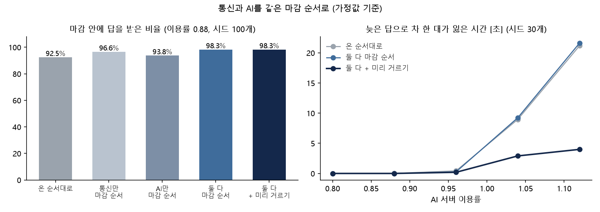
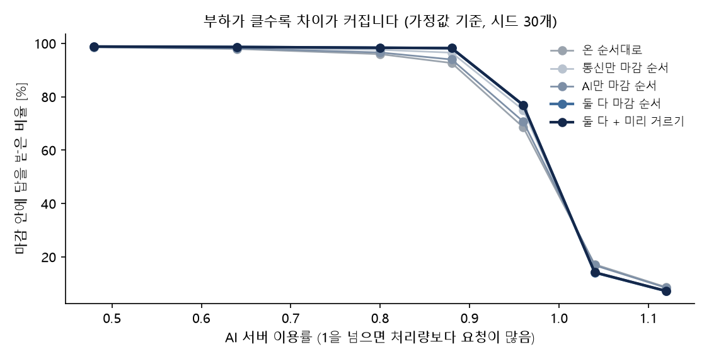

# 마감시각 순서 모의실험

차가 계산한 "답의 마감시각" 하나로 통신 줄과 기지국 옆 AI 줄을 함께 세우면, 마감 안에 답을 받는 차가 얼마나 느는지 본다. 답을 늦게 받은 차가 정지선 앞에 멈췄다 다시 출발하며 잃는 시간도 함께 계산한다. 교통 모의실험(SUMO)을 대신해, 차의 움직임은 속도·감속도로 계산한다.

## 실행

```bash
python deadline_sim.py
```

시드 100개로 1~2분 걸린다. 결과는 `results`에 저장된다.

| 파일 | 내용 |
|---|---|
| `results/deadline_summary.csv` | 방식별 평균과 95% 신뢰구간 |
| `results/deadline_load_sweep.csv` | 요청 도착률(부하)을 바꿔 본 값 |
| `results/fig1_deadline_compare.png` | 방식별 마감 안 답 비율과 잃은 시간 |
| `results/fig2_load_sweep.png` | 부하에 따른 마감 안 답 비율 |

## 무엇을 흉내 내는가

교차로 몇 곳을 맡는 기지국 하나와 그 옆 AI 서버 하나가 있다. 차가 사진을 올려 "지나가도 되나요?"를 물으면 요청은 다음을 차례로 지난다.

1. **올려 보내는 통신.** 모든 차가 나눠 쓰는 무선 구간이다. 한 번에 한 요청씩 보낸다.
2. **AI 서버.** 한 번에 한 요청씩 처리한다.
3. **답을 내려 보냄.** 짧은 답이라 고정 10ms로 둔다.

차의 마감시각은 속도와 정지선까지 거리로 계산한다.

- 정지거리 = v·τ + v²/(2a) + m
- 통신에 쓸 수 있는 시간 = (정지선까지 거리 − 정지거리) ÷ v − 확인 시간

마감 안에 답이 오지 않으면 차는 마감 지점에서 브레이크를 밟기 시작한다. 다 서기 전에 답이 오면 그때 다시 가속하고, 다 섰으면 답을 기다렸다 출발한다. 감속·정지·재출발로 늦어진 시간을 "잃은 시간"으로 센다.


## 비교한 방식

| 이름 | 통신 줄 | AI 줄 | 미리 거르기 |
|---|---|---|---|
| 온 순서대로 | 온 순서 | 온 순서 | 없음 |
| 통신만 마감 순서 | 마감 순서 | 온 순서 | 없음 |
| AI만 마감 순서 | 온 순서 | 마감 순서 | 없음 |
| 둘 다 마감 순서 (ASK) | 마감 순서 | 마감 순서 | 없음 |
| 둘 다 + 미리 거르기 (ASK) | 마감 순서 | 마감 순서 | 지금 시작해도 차가 다 서기 전에 답이 못 갈 요청은 줄에 넣지 않고 바로 "확인 불가"로 돌려보낸다 |

## 가정값

모두 정해 넣은 값이다. 코드의 `PARAMS`와 같아야 한다.

| 항목 | 값 | 정한 근거 |
|---|---|---|
| 요청 도착률 | 초당 11건 | 가정. AI 서버 이용률 약 0.88. 그림 2에서 6~14건으로 바꿔 봤다 |
| 차 속도 | 시속 30~60km | 도심 교차로 접근 |
| 물을 때 정지선까지 거리 | 40~140m | 가정 |
| 반응·작동 지연, 감속도, 안전 여유 | 0.3초, 2m/s², 2m | 부드러운 제동 가정. 제안서의 계산 예와 같은 감속도 |
| 다시 출발할 때 가속도 | 1.5m/s² | 가정 |
| 차가 답을 확인하는 시간 | 50ms | 가정 |
| 사진 크기 | 100~300KB | 가정 |
| 혼잡할 때 이 요청들의 올림 속도 | 22Mbit/s | 가정. 통신 이용률 약 0.91. 통신과 AI가 함께 붐비는 상황 |
| 무선 구간 고정 지연, 답 내려 보내기 | 10ms, 10ms | 가정 |
| AI 처리 시간 | 평균 80ms, 변동계수 0.5 | 가정 |
| "확인 불가"를 받고 선 차가 스스로 확인하는 시간 | 1초 | 가정 |
| 한 번 실험 길이 | 300초 | |

마감이 0.1초도 남지 않은 요청(처음부터 멈춰야 하는 차)은 평가에서 뺐다. 전체 요청의 약 12%다.

## 결과

시드 100개 평균이다. 통신 이용률 약 0.91, AI 서버 이용률 약 0.88로 둘 다 붐빈다.

| 방식 | 마감 안 답 | 늦은 답 | 미리 거름 | 차 한 대가 잃은 시간 평균 | 응답 시간 P99 |
|---|--:|--:|--:|--:|--:|
| 온 순서대로 | 92.5% | 7.5% | 0% | 0.01초 | 2.31초 |
| 통신만 마감 순서 | 96.6% | 3.4% | 0% | 0.00초 | 5.63초 |
| AI만 마감 순서 | 93.8% | 6.2% | 0% | 0.00초 | 3.53초 |
| 둘 다 마감 순서 | 98.3% | 1.7% | 0% | 0.00초 | 6.22초 |
| 둘 다 + 미리 거르기 | 98.3% | 1.7% | 0% | 0.00초 | 6.22초 |

이 부하에서는 늦은 답도 아주 조금만 늦어, 차가 감속하는 도중에 도착한다. 완전히 선 차가 없어 잃은 시간은 거의 0이다.

부하를 바꿔 본 값(시드 30개)이다.

| AI 서버 이용률 | 0.48 | 0.64 | 0.80 | 0.88 | 0.96 | 1.04 | 1.12 |
|---|--:|--:|--:|--:|--:|--:|--:|
| **마감 안 답** | | | | | | | |
| 온 순서대로 | 98.5% | 97.9% | 96.0% | 92.6% | 68.6% | 17.2% | 8.6% |
| 둘 다 마감 순서 | 98.8% | 98.6% | 98.4% | 98.2% | 76.8% | 14.1% | 7.2% |
| 둘 다 + 미리 거르기 | 98.8% | 98.6% | 98.4% | 98.2% | 76.9% | 14.2% | 7.2% |
| **차 한 대가 잃은 시간** | | | | | | | |
| 온 순서대로 | 0초 | 0초 | 0.00초 | 0.01초 | 0.43초 | 8.96초 | 21.2초 |
| 둘 다 마감 순서 | 0초 | 0초 | 0초 | 0초 | 0.27초 | 9.24초 | 21.6초 |
| 둘 다 + 미리 거르기 | 0초 | 0초 | 0초 | 0초 | 0.19초 | 2.91초 | 3.99초 |





## 읽는 법

- **한 줄만 마감 순서로 바꾸면 효과가 반쪽이다.** 통신만 바꾸면 AI 줄에서, AI만 바꾸면 통신 줄에서 다시 늦는다. 둘 다 같은 순서로 세울 때 늦은 답이 7.5%에서 1.7%로 준다.
- **그러나 이용률 0.88까지는 교통에 거의 영향이 없다.** 늦은 답이 0.1~1초만 늦어 차가 살짝 감속하고 다시 간다. 마감 안 답 비율의 차이를 "교통이 좋아진다"로 읽으면 안 된다.
- **차이는 처리량 가까이에서 난다.** 이용률 0.96에서 차 한 대가 잃은 시간은 0.43초(온 순서) → 0.27초(둘 다 마감 순서) → 0.19초(미리 거르기)다. 이용률 1.04에서는 순서만으로는 나아지지 않고(9.0초 → 9.2초), 미리 거르기가 2.9초로 줄인다.
- **미리 거르기는 "어차피 설 차"만 거른다.** 조금 늦을 요청까지 거르면 감속만 하고 지나갈 차를 세우게 된다. 지금 기준에서는 처리량에 여유가 있을 때 거르는 요청이 0이다.
- **불리한 점: 마감이 먼 요청은 더 기다린다.** 마감 순서는 여유 있는 요청을 뒤로 미루므로 응답 시간 P99가 2.3초에서 6.2초로 늘어난다. 그래도 그 요청들은 마감 안에 답을 받는다.

## 이 실험이 말하지 못하는 것

- 무선 구간은 "한 번에 하나씩 보내는 줄"로 단순화했다. 실제 5G의 자원 나누기, 전파 환경, 재전송은 들어 있지 않다. 이 부분은 ns-3 5G-LENA 같은 통신 시뮬레이터로 따로 확인해야 한다.
- 차의 움직임은 속도·감속도 계산이다. 다른 차와의 간격, 뒤차의 정지는 [SUMO 모의실험](../sumo_crossing/README.md)에서 따로 본다.
- 실제 기지국이 바깥 서비스의 마감시각대로 순서를 바꿔 주려면 통신사와 함께 만들어야 한다(제안 범위).
