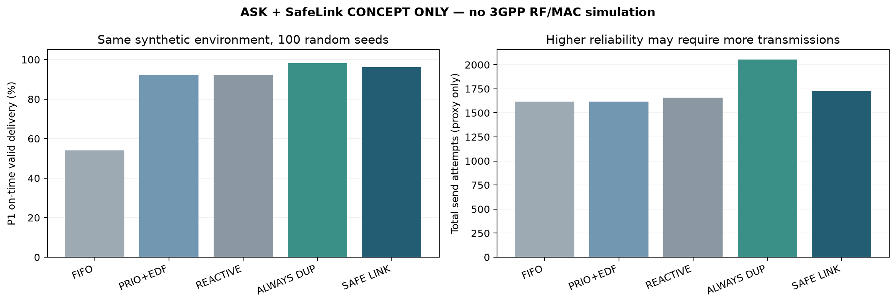

# SafeLink 긴급 정보 전달 모의실험

차량과 교차로 간 통신의 혼잡·단절 상황에서 긴급 정보가 유효한 상태로 제시간에 도착하는 비율을 다섯 가지 전송 방식으로 비교합니다. 통신 모듈 SafeLink의 동작을 검증합니다.

## 실행 방법

```bash
python safelink_demo.py --seed 20261112 --reactive-setup-ms 80
```

```bash
python safelink_eval.py
```

첫 번째 명령은 단일 시드로 1회 실행합니다. 두 번째 명령은 시드 100개와 보조 경로 준비 시간 네 가지(0, 40, 80, 160ms)로 반복 실행합니다. `safelink_eval.py`는 같은 폴더의 `safelink_demo.py`를 사용합니다.

| 파일 | 내용 |
|---|---|
| `results/ASK_SafeLink_metrics.csv` | 단일 실행 결과 |
| `results/ASK_SafeLink_comparison.png` | 전송 횟수와 전달률의 산점도 |
| `results/ASK_SafeLink_repeated_summary.csv` | 시드 100개 평균 및 95% 신뢰구간 |
| `results/ASK_SafeLink_repeated_results.png` | 방식별 전달률과 전송 횟수 막대그래프 |

시드별 원자료(`*_raw.csv`)는 재생성할 수 있으므로 저장소에 포함하지 않습니다.

## 모델 구성

30초 동안 초당 약 54개의 메시지가 발생합니다. 메시지는 긴급·중요·일반 세 등급으로 나뉘며, 정지선까지의 거리로 응답 기한이 정해집니다. 전송 경로는 두 가지입니다.

| 경로 | 코드 이름 | 모델링 내용 |
|---|:-:|---|
| 기지국 경유 경로 | A | 다른 사용자와 공유하는 대기열이 존재하며, 혼잡 시 처리 지연과 손실이 증가함 |
| 보조 경로 | B | 교차로 장치에서 차량으로 직접 전달되는 경로로 대기열이 없음. 두 경로가 동시에 악화되는 구간이 있음 |

| 시간대 | 기지국 경로 | 보조 경로 |
|---|---|---|
| 평시 | 손실 2.5% | 손실 3.5% |
| 12~13초 | 품질 저하 시작, 손실 7% | 평시와 동일 |
| 13~18초 | 혼잡: 처리 시간 2.2배, 손실 15% | 손실 6.5% |
| 21~22.5초 | 장애: 손실 70% | 손실 50% (동시 악화) |

긴급 정보는 응답 기한과 허용 정보 나이(0.23초)를 모두 만족해야 "제시간 유효 도착"으로 집계합니다.

## 비교 대상

| 코드 이름 | 방식 | 동작 |
|---|---|---|
| `FIFO_A` | 도착 순서 | 기지국 경로에서 먼저 도착한 메시지부터 전송 |
| `PRIO_EDF_A` | 긴급 순서 | 긴급 등급 우선, 동일 등급은 마감시각이 빠른 순으로 전송 |
| `REACTIVE` | 장애 시 경로 전환 | 120ms 내 응답이 없으면 보조 경로로 재전송 |
| `ALL_P1_DUP` | 항상 두 경로 | 긴급 메시지를 항상 두 경로로 동시 전송 |
| `SAFE_LINK` | 필요할 때만 두 경로 | 신호 품질이 낮거나 기한이 0.2초 미만일 때만 두 경로로 전송 |

## 실험 결과

시드 100개, 보조 경로 준비 시간 80ms 조건입니다.

| 방식 | 제시간 유효 도착 비율 | 95% 신뢰구간 | 평균 전송 횟수 | 추가 전송 |
|---|--:|:-:|--:|--:|
| 도착 순서 | 53.94% | 52.68 ~ 55.20 | 1,617.1 | 0 |
| 긴급 순서 | 92.14% | 91.89 ~ 92.38 | 1,617.1 | 0 |
| 장애 시 경로 전환 | 92.14% | 91.89 ~ 92.38 | 1,658.9 | 41.8 |
| 항상 두 경로 | 98.14% | 98.02 ~ 98.26 | 2,053.5 | 436.4 |
| 필요할 때만 두 경로 | 96.23% | 96.05 ~ 96.41 | 1,725.2 | 108.0 |



보조 경로 준비 시간을 0ms로 설정하면 "장애 시 경로 전환"이 98.18%로 가장 높습니다. 나머지 방식은 준비 시간의 영향을 받지 않습니다.

## 결과 해석

- **긴급 순서 전송의 효과가 가장 큽니다.** 전달률이 54%에서 92%로 상승합니다.
- **두 경로를 사용하면 96~98%에 도달합니다.** 추가 전송량은 항상 두 경로가 27%, 필요할 때만 두 경로가 7%입니다.
- **필요할 때만 두 경로가 항상 두 경로보다 우수하다고 해석해서는 안 됩니다.** 전달률은 1.9%p 낮으며, 장점은 추가 전송량이 적다는 점입니다.

## 한계 및 적용 범위

- 실제 5G 무선 구간, 재전송, 전파 환경은 구현하지 않았습니다. 보조 경로는 직접통신을 가정한 가상 경로입니다.
- 보조 경로의 용량 제한이 없어, 다수 차량의 중복 전송에 따른 혼잡은 반영되지 않습니다.
- 통신 품질 판단은 현재 신호 품질 값을 기준으로 하며, 학습 기반 예측은 포함하지 않습니다.
- 차량 이동은 모델에 포함하지 않았으므로, 정지선 침범과 같은 주행 결과는 이 실험의 범위가 아닙니다.
