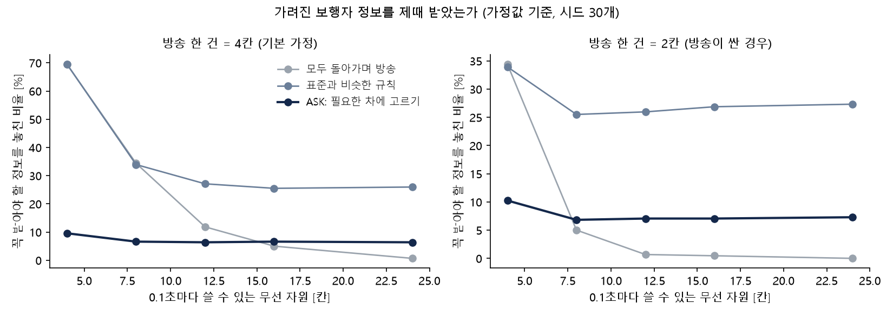

# 정보 선택 모의실험

노변 센서가 관측한 보행자 정보를 차량별 필요도에 따라 선택해 전송할 때, 무선 자원이 부족한 조건에서 가려진 차량의 필수 정보 누락이 감소하는지 분석합니다. 가림 여부는 대형 차량과 시선의 실제 좌표로 계산합니다.

## 실행 방법

```bash
python selection_sim.py
```

시드 100개 기준 약 2~3분이 소요되며, 결과는 `results` 폴더에 저장됩니다.

| 파일 | 내용 |
|---|---|
| `results/selection_summary.csv` | 방식별 누락률, 사용 자원, 유효 수신 비율(일반·혼잡 교차로) |
| `results/selection_sweep.csv` | 무선 자원량과 방송 비용 변화에 따른 결과 |
| `results/selection_error_sweep.csv` | 노변 센서 추정 오차 변화에 따른 결과 |
| `results/fig1_selection_sweep.png` | 무선 자원량에 따른 누락률 |

## 모델 구성

4지 교차로에서 8초 동안을 0.1초 단위로 계산합니다.

- 차량 24대(방향별 6대)가 바깥 차로로 정지선에 접근하며, 직진·좌회전·우회전 중 하나를 수행합니다.
- 보행자 12명이 네 개의 횡단보도를 보행합니다.
- 방향별 50% 확률로 안쪽 차로에 대형 차량이 정차해 있으며, 차량과 보행자를 잇는 시선이 대형 차량을 통과하면 가림으로 판정합니다.
- 노변 센서는 보행자를 상부에서 관측하며(미검출 5%), 관측부터 전송까지 0.15초가 소요됩니다.

**필수 수신 쌍.** 차량이 통과할 횡단보도에 보행자가 있고, 차량의 제동 개시 시점(마감시각)에 해당 보행자가 차량 센서로 보이지 않는 경우입니다. 마감시각 기준 0.5초 이내의 관측 정보를 수신하지 못하면 "누락"으로 집계합니다.

**무선 자원.** 0.1초마다 정해진 자원 단위만 사용할 수 있습니다. 개별 전송은 1단위, 수신 성공률 98%입니다. 방송은 최저 채널 차량에 맞춰야 하므로 4단위, 수신 성공률 90%입니다.

## 비교 대상

| 방식 | 선택 기준 |
|---|---|
| 전체 순환 방송 | 센서가 관측한 보행자를 순차적으로 방송 |
| 표준 유사 규칙 | 0.5초 경과 또는 1m 이상 이동한 보행자만 방송. 협력 인지 표준 규칙의 약식 구현으로, 실제 표준 규칙과는 다름 |
| ASK | 차량별 정보 가치(충돌 관련성 × 가림 × 새로움 × 마감 전 도착 가능성)를 계산. 가려져 있고 마감이 1.5초 이내인 쌍은 점수와 무관하게 우선 전송. 동일 보행자가 필요한 차량이 4대 이상이면 방송, 그 미만이면 개별 전송 |

ASK는 노변 센서의 추정값으로 전송 대상을 선택합니다. 차량 진행 방향은 10%의 차량에서 잘못 추정하고, 차량별 가시 여부도 매 시점 10% 확률로 잘못 판단하도록 설정했습니다. 평가는 실제 값으로 수행합니다.

## 가정 조건

| 항목 | 값 | 설정 근거 |
|---|---|---|
| 차량, 보행자 | 24대, 12명 (혼잡: 40대, 20명) | 가정 |
| 초기 정지선 거리, 속도 | 25~140m, 시속 30~50km | 가정 |
| 대형 차량 정차 확률 | 방향별 50% | 가정 |
| 차량 자체 센서 감지 거리 | 80m | 가정 |
| 노변 센서 미검출 확률 | 5% | 가정 |
| 노변 센서 처리 지연, 정보 유효기간 | 0.15초, 0.5초 | 가정 |
| 무선 자원 | 0.1초당 8단위 | 가정. 4~24단위 범위로 변화 |
| 방송 비용, 수신 성공률 | 4단위·90%, 개별 전송 1단위·98% | 가정. 방송 비용 2단위 조건도 분석 |
| 반응 지연, 감속도, 안전 여유 | 0.3초, 2m/s², 2m | 마감시각 모의실험과 동일 |
| ASK 추정 오차 | 진행 방향 10%, 가림 10% | 가정. 0~30% 범위로 변화 |

## 실험 결과

시드 100개 합계입니다.

| 교차로 | 방식 | 필수 수신 쌍 | 누락률 | 사용 자원 [단위/초] | 유효 수신 비율 |
|---|---|--:|--:|--:|--:|
| 일반 | 전체 순환 방송 | 1,518 | 36.4% | 80 | 14% |
| 일반 | 표준 유사 규칙 | 1,518 | 36.5% | 80 | 14% |
| 일반 | ASK | 1,518 | **7.0%** | 28 | 40% |
| 혼잡 | 전체 순환 방송 | 4,515 | 64.1% | 80 | 15% |
| 혼잡 | 표준 유사 규칙 | 4,515 | 63.7% | 80 | 15% |
| 혼잡 | ASK | 4,515 | **14.0%** | 62 | 38% |

노변 센서 추정 오차에 따른 ASK 누락률(시드 30개, 진행 방향과 가림에 동일 오차 적용)은 다음과 같습니다.

| 추정 오차 | 0% | 5% | 10% | 20% | 30% |
|---|--:|--:|--:|--:|--:|
| ASK 누락률 | 0.0% | 3.9% | 6.6% | 11.6% | 21.2% |



## 결과 해석

- **무선 자원이 부족할 때 정보 선택의 효과가 큽니다.** 0.1초당 8단위, 방송 4단위 조건에서 누락률은 전체 순환 방송 36%, ASK 7%이며, ASK의 자원 사용량은 3분의 1 수준입니다.
- **불리한 조건: 자원이 충분하고 방송 비용이 낮으면 전체 방송이 우수합니다.** 방송 2단위, 자원 12단위 이상에서 전체 방송의 누락률은 약 1%인 반면 ASK는 약 7%에서 더 낮아지지 않습니다. ASK 누락의 대부분은 노변 센서의 진행 방향·가림 추정 오차에서 발생하며, 추정이 정확하면 0%, 오차 30%에서는 21%입니다.
- **따라서 정보 선택은 전체 방송을 대체하지 않고 보완합니다.** 자원이 충분할 때는 방송 비중을 높이고, 자원이 부족할 때 선택 전송으로 전환하는 운용이 적절합니다. 차량이 진행 방향을 직접 공유(방향 지시, 경로 공유)하면 추정 오차를 줄일 수 있습니다.
- **"표준 유사 규칙"이 자원이 늘어도 25% 아래로 내려가지 않는 이유**는 0.5초 갱신 간격이 정보 유효기간(0.5초)과 센서 지연(0.15초)을 고려한 허용 범위보다 길기 때문입니다. 이는 약식 규칙의 한계이며, 실제 표준의 성능을 의미하지 않습니다.

## 한계 및 적용 범위

- 무선 자원을 "단위"로 단순화했습니다. 실제 5G 방송(MBS)과 개별 전송의 비용 비율은 채널 상태와 장비에 따라 달라집니다.
- 차량은 등속으로 접근하며, 정보 수신 여부에 따라 속도를 바꾸지 않습니다. 정보 누락이 실제 사고로 이어지는지는 다루지 않습니다.
- 보행자는 횡단보도 위에서만 이동하며, 무단횡단, 자전거, 기상에 따른 센서 성능 저하는 포함하지 않았습니다.
