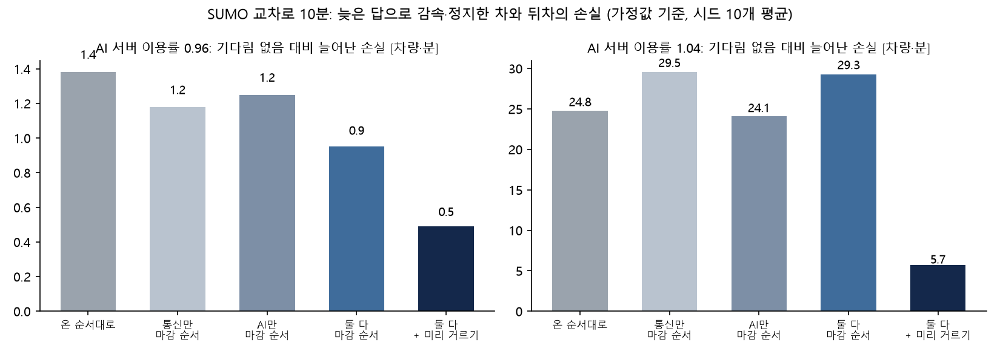

# SUMO 교통 모의실험: 늦은 답이 뒤차까지 막는가

교통 모의실험 프로그램 SUMO로 교차로 하나를 만들고, 정지선 앞에서 묻는 차의 답이 늦으면 그 차와 뒤차가 얼마나 시간을 잃는지 본다. 답이 오는 시간은 [마감시각 모의실험](../deadline/README.md)의 방식별 결과에서 가져온다.

## 실행

SUMO가 필요하다.

```bash
pip install eclipse-sumo traci
```

```bash
python crossing_sumo.py
```

부하 두 가지 × 방식 여섯 가지 × 시드 10개로 10분 정도 걸린다. 도로망은 실행할 때 `net`에 만든다. 결과는 `results`에 저장된다.

| 파일 | 내용 |
|---|---|
| `results/sumo_summary.csv` | 부하와 방식별 평균 |
| `results/fig1_sumo_compare.png` | 기다림 없음 대비 늘어난 손실 시간 |

만든 환경은 SUMO 1.28.0(PyPI `eclipse-sumo`)이다.

## 무엇을 흉내 내는가

- 남북으로 지나는 큰길과 동쪽 작은 길이 만나는 교차로다. 큰길은 한 방향 한 차로, 길이 400m, 제한 속도 시속 50km다.
- 10분 동안 방향마다 시간당 600대가 들어온다. 차의 속도는 제한 속도의 ±8% 안에서 다르다.
- 30%의 차가 정지선 60~140m 앞에서 "지나가도 되나요?"를 묻는다.
- 답이 오는 시간은 마감시각 모의실험에서 마감이 비슷한 요청 하나를 골라 쓴다. 같은 방식, 같은 부하의 결과다.
- 마감 안에 답이 오면 그대로 간다. 늦으면 마감 지점에서 감속을 시작하고(2m/s²), 서기 전에 답이 오면 다시 간다. 다 섰으면 답을 기다린다. "확인 불가"를 받은 차는 서서 1초 스스로 확인하고 출발한다.
- 묻지 않은 차도 앞차가 서거나 느려지면 뒤에서 함께 느려진다. 이것이 SUMO로 보려는 부분이다.

SUMO의 `timeLoss`(제한 속도로 달렸을 때보다 늦어진 시간)로 손실을 잰다. "기다림 없음"은 묻는 차가 있어도 답이 늘 제때 오는 경우이고, 다른 방식은 이 기준보다 늘어난 손실로 비교한다.

## 가정값

| 항목 | 값 | 정한 근거 |
|---|---|---|
| 들어오는 차 | 방향마다 시간당 600대, 10분 | 가정 |
| 묻는 차 비율 | 30% | 가정. 요청이 몰리는 사건 중 |
| 물을 때 정지선까지 거리 | 60~140m | 가정 |
| 감속도, 가속도 | 2.0m/s², 1.5m/s² | 마감시각 모의실험과 같다 |
| 답이 오는 시간 | 마감시각 모의실험의 결과 (AI 서버 이용률 0.96, 1.04) | 이용률 0.88 이하는 늦은 답이 거의 손실을 내지 않아 뺐다 |
| "확인 불가"를 받은 차의 자체 확인 | 1초 | 가정 |

## 결과

시드 10개 평균이다. 추가 손실은 "기다림 없음"보다 늘어난 손실 시간을 모든 차에 대해 더한 값이다.

**처리량 가까이 (AI 서버 이용률 0.96)**

| 방식 | 감속한 차 [대] | 추가 손실 [차량·분] | 묻지 않은 차의 평균 손실 | 가장 긴 정지 줄 |
|---|--:|--:|--:|--:|
| 기다림 없음 (기준) | 0 | 0 | 2.36초 | 0대 |
| 온 순서대로 | 18.2 | 1.38 | 2.65초 | 0.9대 |
| 통신만 마감 순서 | 12.9 | 1.18 | 2.55초 | 1.0대 |
| AI만 마감 순서 | 18.2 | 1.25 | 2.66초 | 0.9대 |
| 둘 다 마감 순서 | 10.6 | 0.95 | 2.56초 | 1.0대 |
| 둘 다 + 미리 거르기 | 13.9 | **0.49** | 2.47초 | 0.3대 |

**처리량을 넘을 때 (AI 서버 이용률 1.04)**

| 방식 | 감속한 차 [대] | 추가 손실 [차량·분] | 묻지 않은 차의 평균 손실 | 가장 긴 정지 줄 |
|---|--:|--:|--:|--:|
| 기다림 없음 (기준) | 0 | 0 | 2.36초 | 0대 |
| 온 순서대로 | 49.6 | 24.8 | 8.33초 | 6.1대 |
| 통신만 마감 순서 | 50.8 | 29.5 | 9.67초 | 6.7대 |
| AI만 마감 순서 | 48.2 | 24.1 | 8.25초 | 7.0대 |
| 둘 다 마감 순서 | 50.2 | 29.3 | 9.51초 | 6.8대 |
| 둘 다 + 미리 거르기 | 51.5 | **5.7** | 3.45초 | 1.1대 |



## 읽는 법

- **늦은 답은 뒤차까지 막는다.** 처리량을 넘으면 묻지 않은 차의 평균 손실도 2.4초에서 8.3초로 는다. 정지선 앞에 선 차 뒤로 6~7대가 줄을 선다.
- **처리량 가까이에서는 마감 순서가 손실을 줄인다.** 온 순서 1.38 → 둘 다 마감 순서 0.95 → 미리 거르기 0.49 차량·분이다(온 순서 대비 64% 감소).
- **처리량을 넘으면 순서만으로는 오히려 나빠진다.** 마감 순서는 급한 요청을 먼저 처리하지만, 그 뒤로 밀린 요청은 더 늦어 결국 선다. 이때는 "어차피 설 요청"을 미리 걸러 줄을 줄이는 것이 효과가 크다(24.8 → 5.7, 77% 감소).
- **처리량에 여유가 있으면(이용률 0.88 이하) 방식 사이 교통 차이는 거의 없다.** 그래서 이 실험에서 뺐다.

## 이 실험이 말하지 못하는 것

- 교차로 하나, 큰길 한 차로다. 신호, 차로 변경, 다른 교차로로 번지는 정체는 없다.
- 답 지연은 마감시각 모의실험(무선 구간을 단순화한 모델)에서 가져왔다. 실제 5G 지연이 아니다.
- 시드가 10개라 신뢰구간이 넓다. 예를 들어 이용률 0.96의 "온 순서대로" 추가 손실은 1.38 ± 0.64 차량·분이다(`sumo_summary.csv`).
- 정지선을 넘는 경우는 없다. 늦은 차는 언제나 마감 지점에서 감속하도록 만들었기 때문이다. 실제 차의 제동 판단은 차의 몫이다.
