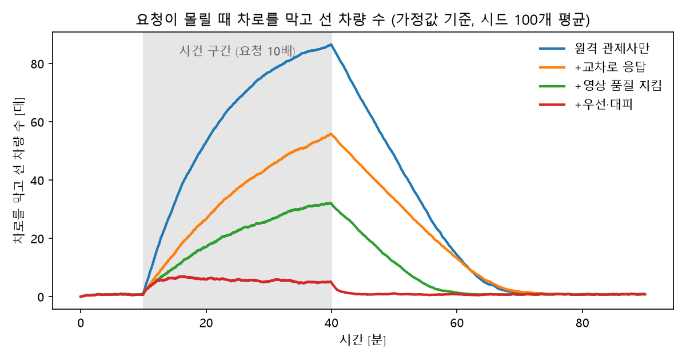

# 요청 폭주 모의실험

무인 자율주행차 200대가 운행하는 도시에서 정전과 같은 사건으로 원격지원 요청이 30분간 집중되는 상황을 모의합니다. ASK의 단계를 순차적으로 추가하면서 차로 점유 시간의 감소 정도를 비교합니다.

## 실행 방법

```bash
python surge_sim.py
```

```bash
python surge_sim.py --seeds 20
```

첫 번째 명령은 시드 100개로 실행합니다(약 1~2분). 두 번째 명령은 빠른 확인용입니다. 결과는 `results` 폴더에 저장됩니다.

| 파일 | 내용 |
|---|---|
| `results/surge_summary.csv` | 방식별 평균 및 95% 신뢰구간 |
| `results/fig1_blocking_over_time.png` | 시간에 따른 차로 점유 차량 수 |
| `results/fig2_resolve_ratio_sweep.png` | 교차로 응답 해결률에 따른 총 점유 시간 |

## 모델 구성

2초 간격으로 다음 과정을 순서대로 계산합니다.

1. 운행 중인 차량 일부가 원격지원을 요청합니다. 사건 구간에는 요청률이 10배로 증가합니다.
2. 확인형 질의는 교차로 장치와 기지국 옆 AI가 먼저 응답합니다. 해결된 차량은 운행을 재개하고, 미해결 차량은 원격 관제사에게 이관됩니다.
3. 응답 기한을 초과한 차로 점유 차량은 갓길 대피를 1회 시도합니다.
4. 대기 중인 차량에 가용 관제사를 배정합니다. 배정 순서는 요청 순 또는 차로 점유 차량 우선입니다.
5. 관제사가 요청을 처리합니다. 통신 혼잡 시에는 관제 영상 품질 저하로 처리 속도가 감소합니다.

요청 차량은 해결 시까지 정지하며, 그중 일부가 차로를 점유합니다.

## 비교 대상

아래로 갈수록 기능이 하나씩 추가됩니다.

| 방식 | 추가 기능 | ASK 단계 |
|---|---|---|
| 원격 관제사만 | 관제사가 요청 순서대로 처리 | 현행 방식 |
| +교차로 응답 | 확인형 질의를 교차로 장치와 기지국 옆 AI가 먼저 응답 | 2단계 |
| +영상 품질 유지 | 관제사 배정 차량의 관제 영상 품질 유지 | 3단계 |
| +우선·대피 | 차로 점유 차량 우선 배정, 기한 초과 시 갓길 대피 | 3, 4단계 |

## 가정 조건

모든 값은 설정값이며, 코드의 `PARAMS`와 일치합니다.

| 항목 | 값 | 설정 근거 |
|---|---|---|
| 운행 차량 | 200대 | 광주 실증도시 규모 |
| 원격 관제사 | 5명 | 차량 40대당 1명. 웨이모의 차량 약 3,000대 대비 원격지원 인력 약 70명과 유사한 비율 |
| 평시 요청 빈도 | 차량 1대당 2시간에 1회 | 가정(공개 수치 없음) |
| 사건 중 요청 배수 | 10배 | 가정 |
| 사건 지속 시간 | 30분 | 가정 |
| 확인형 질의 비율 | 평시 50%, 사건 중 70% | 가정(정전 시 신호 소등 확인 요청 증가 반영) |
| 요청 차량의 차로 점유 확률 | 60% | 가정 |
| 관제사 처리 시간 | 확인형 평균 20초, 복합 질의 평균 90초 | 가정 |
| 교차로 응답 해결률 | 80% | 가정. 그림 2에서 0~95% 범위로 변화 |
| 교차로 응답 시간 | 4초 | 가정 |
| 혼잡 시 관제 영상 품질 | 50% (처리 속도 절반) | 가정 |
| 대피 판단 기한 | 60초 | 가정 |
| 대피 성공 확률 | 70% | 가정. 결과에 대한 영향이 가장 큼 |

## 실험 결과

시드 100개 평균이며, ± 값은 95% 신뢰구간의 반폭입니다.

| 방식 | 차로 점유 차량·분 | 원격 관제사만 대비 감소 | 동시 정지 차량 최대 | 요청 95% 해결 시간 |
|---|--:|--:|--:|--:|
| 원격 관제사만 | 2,853 ± 58 | 기준 | 146대 | 1,462초 |
| +교차로 응답 | 1,777 ± 57 | 37.8% ± 1.4 | 96대 | 1,364초 |
| +영상 품질 유지 | 919 ± 46 | 68.1% ± 1.2 | 60대 | 708초 |
| +우선·대피 | 216 ± 4 | 92.4% ± 0.1 | 59대 | 1,067초 |

차로 점유 차량·분은 차로를 점유한 차량 수를 시간에 대해 합산한 값입니다(예: 10대가 3분간 점유하면 30).




## 결과 해석

- **원격 관제사만으로는 요청 집중에 대응하기 어렵습니다.** 200대 중 최대 146대가 동시에 정지하며, 평시에 충분한 인력도 사건 시에는 크게 부족합니다.
- **교차로 응답만으로는 효과가 제한적입니다.** 감소율은 38%에 그치며, 남은 복합 질의가 원격 관제사에게 집중됩니다.
- **통신 지원이 함께 필요합니다.** 관제 영상 품질을 유지하면 감소율이 68%까지 높아집니다.
- **마지막 단계의 92%는 가정에 크게 의존합니다.** 대피 성공 확률(70%)에 따라 값이 달라지므로 대표 수치로는 68%를 사용합니다.
- **우선 배정에는 비용이 따릅니다.** 차로를 점유하지 않은 차량의 대기가 길어져 요청 95% 해결 시간이 708초에서 1,067초로 증가합니다.

## 한계 및 적용 범위

- 요청 빈도, 처리 시간, 대피 성공률은 공개된 운영 수치가 없어 가정값을 사용했습니다.
- 통신은 "혼잡 시 관제 영상 처리 속도 50% 저하"로만 반영했습니다. 통신 모듈의 효과는 [safelink](../safelink/README.md)에서 별도로 검증합니다.
- 차량 위치와 도로 구조는 모델에 포함하지 않았으므로, 교차로별 정체는 다루지 않습니다.
- 동일 시드에서는 동일 차량이 동일 시점에 같은 난수를 사용하도록 했으나, 방식별 정지 시간 차이로 인해 요청 발생 차량은 방식마다 일부 달라집니다.
