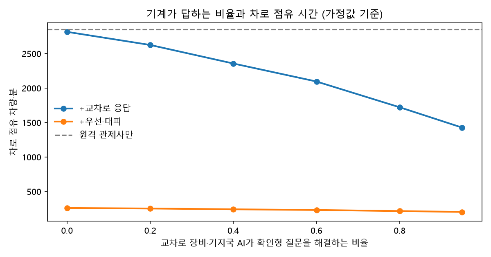

# 요청 폭주 모의실험

무인 자율주행차 200대가 달리는 도시에서 정전 같은 사건이 터져 도움 요청이 한꺼번에 몰리는 30분을 흉내 낸다. ASK의 단계를 하나씩 더했을 때 차가 도로를 막고 선 시간이 얼마나 주는지 본다.

## 실행

```bash
python surge_sim.py
```

```bash
python surge_sim.py --seeds 20
```

앞의 것은 시드 100개로 돌린다(1~2분). 뒤의 것은 빠르게 확인할 때 쓴다. 결과는 `results`에 저장된다.

| 파일 | 내용 |
|---|---|
| `results/surge_summary.csv` | 방식별 평균과 95% 신뢰구간 |
| `results/fig1_blocking_over_time.png` | 시간에 따라 차로를 막고 선 차량 수 |
| `results/fig2_resolve_ratio_sweep.png` | 기계가 답하는 비율에 따른 총 점유 시간 |

## 무엇을 흉내 내는가

2초마다 다음을 차례로 계산한다.

1. 달리던 차량 가운데 일부가 도움을 요청한다. 사건이 진행 중이면 요청이 10배로 는다.
2. 확인형 질문은 교차로 장비와 기지국 AI가 먼저 답한다. 해결되면 차량은 다시 달리고, 안 되면 사람에게 넘어간다.
3. 기한을 넘긴 차로 점유 차량은 갓길로 비키려고 한 번 시도한다.
4. 손이 빈 관제사가 기다리는 차량을 맡는다. 온 순서대로 맡거나, 도로를 막은 차량부터 맡는다.
5. 관제사가 처리한다. 통신이 붐비면 영상이 느려 처리도 느려진다.

요청한 차량은 해결될 때까지 멈춰 있고, 그 가운데 일부가 차로를 막는다.

## 비교한 방식

아래로 갈수록 기능이 하나씩 더해진다.

| 이름 | 더해진 것 | ASK의 단계 |
|---|---|---|
| 원격 관제사만 | 관제사가 온 순서대로 처리한다 | 지금의 방식 |
| +교차로 응답 | 확인형 질문은 교차로 장비와 기지국 AI가 먼저 답한다 | 2단계 |
| +영상 품질 지킴 | 관제사가 맡은 차량의 영상 품질을 지킨다 | 3단계 |
| +우선·대피 | 도로를 막은 차량부터 맡고, 기한을 넘기면 갓길로 비킨다 | 3, 4단계 |

## 가정값

모두 정해 넣은 값이다. 코드의 `PARAMS`와 같아야 한다.

| 항목 | 값 | 정한 근거 |
|---|---|---|
| 운행 차량 | 200대 | 광주 실증도시의 규모 |
| 관제사 | 5명 | 차량 40대에 1명. 웨이모가 차량 약 3,000대에 원격지원 인력 약 70명을 둔 것과 비슷한 비율 |
| 평소 요청 빈도 | 차량 1대가 2시간에 1번 | 가정. 공개된 수치가 없다 |
| 사건 중 요청 배수 | 10배 | 가정 |
| 사건 길이 | 30분 | 가정 |
| 확인형 질문 비율 | 평소 50%, 사건 중 70% | 가정. 정전에서는 꺼진 신호등 확인이 많다고 봤다 |
| 요청 차량이 차로를 막을 확률 | 60% | 가정 |
| 관제사 처리 시간 | 확인형 평균 20초, 복잡한 질문 평균 90초 | 가정 |
| 기계가 확인형 질문을 해결하는 비율 | 80% | 가정. 그림 2에서 0~95%로 바꿔 봤다 |
| 기계의 응답 시간 | 4초 | 가정 |
| 혼잡 시 영상 품질 | 절반. 처리 속도가 절반이 된다 | 가정 |
| 대피 판단 기한 | 60초 | 가정 |
| 대피 성공 확률 | 70% | 가정. 결과에 가장 큰 영향을 준다 |

## 결과

시드 100개의 평균이다. ± 뒤의 값은 95% 신뢰구간의 반폭이다.

| 방식 | 차로 점유 차량·분 | 원격 관제사만 대비 감소 | 동시에 멈춘 차량 최대 | 요청의 95%가 해결되는 시간 |
|---|--:|--:|--:|--:|
| 원격 관제사만 | 2,853 ± 58 | 기준 | 146대 | 1,462초 |
| +교차로 응답 | 1,777 ± 57 | 37.8% ± 1.4 | 96대 | 1,364초 |
| +영상 품질 지킴 | 919 ± 46 | 68.1% ± 1.2 | 60대 | 708초 |
| +우선·대피 | 216 ± 4 | 92.4% ± 0.1 | 59대 | 1,067초 |

차로 점유 차량·분은 차로를 막은 차량 수를 시간으로 더한 값이다. 10대가 3분 막으면 30이다.




## 읽는 법

- **원격 관제사만으로는 감당하지 못한다.** 200대 가운데 최대 146대가 동시에 멈춘다. 평소에는 충분한 인원이 사건 때는 크게 모자란다.
- **교차로가 먼저 답하는 것만으로는 부족하다.** 38% 감소에 그친다. 남은 복잡한 질문이 사람에게 몰리기 때문이다.
- **통신이 함께 받쳐 줘야 한다.** 영상 품질을 지키면 68%까지 준다.
- **마지막 단계의 92%는 가정에 크게 좌우된다.** 대피 성공 확률 70%가 바뀌면 값이 달라진다. 대표 수치로는 68%를 쓴다.
- **우선 배정에는 대가가 있다.** 도로를 막지 않은 차량의 대기가 길어져, 요청의 95%가 해결되는 시간이 708초에서 1,067초로 는다.

## 한계

- 요청 빈도, 처리 시간, 대피 성공률에 근거가 없다. 운영 수치가 공개돼 있지 않다.
- 통신은 "혼잡하면 영상이 절반으로 느려진다"는 한 줄로만 들어 있다. 통신 모듈의 효과는 [safelink](../safelink/README.md)에서 따로 본다.
- 차량의 위치와 도로 구조가 없다. 어느 교차로가 막히는지는 보지 않는다.
- 같은 시드에서 같은 차량이 같은 시각에 같은 난수를 받도록 했지만, 방식에 따라 차량이 멈춰 있는 시간이 달라서 요청이 생기는 차량은 방식마다 조금씩 다르다.
